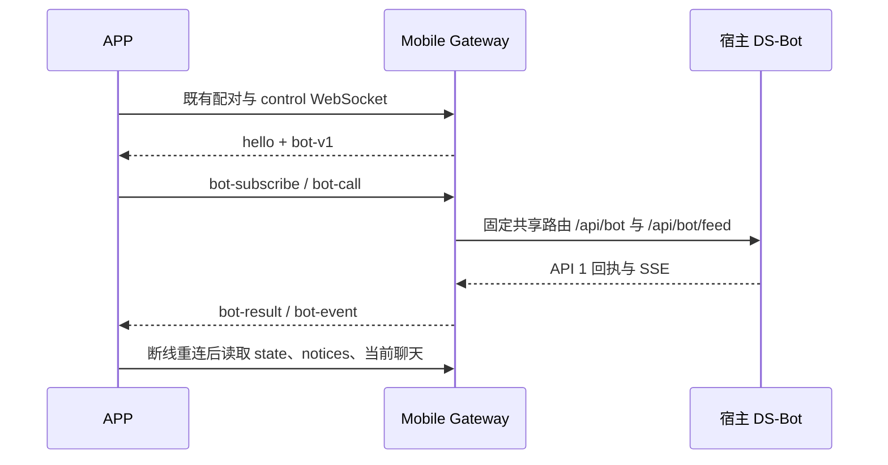

# Bot 模式首版接入

## 产品范围

从工作首页抽屉进入「Bot 模式」，模式选择会保留。首页展示 Chief、正在处理事情的 Bot、近期明确完成的工作、定时任务入口，以及混排的群聊与私聊。手机打开独立聊天页；宽窗口采用 R2 主页，左侧为助理和任务概览，右侧为可搜索的聊天列表，点击后也进入独立聊天页。

私聊使用头像与左右气泡，支持流式文本、历史分页和发送状态；群聊增加发言者身份，按房间事件刷新最终消息。提问支持单选、多选和补充回答；审批仅提供拒绝与单次允许。

当前定时任务界面只读。完成记录来自 DS-Bot 的 `done` 提醒，不会根据普通回复猜测任务完成。上游提醒保留在主机内存中，本地最多缓存近期 30 条，不能作为完整的永久任务档案。

## 已批准设计的实现

设计依据：[Bot 模式 Figma](https://www.figma.com/design/ZUTrLysFm9CZlTW51W7pj5)，手机首页 `7:58`、私聊 `7:61`、群聊 `7:64`、定时任务 `7:67`、平板 `7:511`、抽屉 `26:1317`。

- 入口固定在原有右滑抽屉首项，24 点黑色 DS Bot 原始矢量；反向入口返回工作模式，选择后立即关闭抽屉并保存模式。
- 品牌、右上角连接配对和设置按钮、主机选择器延用原布局及真实操作。背景保留流体几何、光弧、网格和鲸鱼点阵，只在 Bot 模式换成浅紫色。
- 首页包含 Chief、正在进行、已完成入口、定时任务入口、群聊与私聊；内容与计数来自共享状态，没有硬编码未读数。
- 私聊采用蓝色用户气泡、白色助理气泡及头像；群聊显示发言者。回复复用两端已有 Markdown 组件及复制/选择能力。
- iOS 使用原生导航、Menu、Sheet、Form、文字输入与项目玻璃封装；Android 复用 `DshMenuHost`、`DshMenu`、`DshGlassButton`、`DshLiquidGlassHost`、`WorkspaceDrawer` 和 Markdown 组件。全局错误沿用 `DshAlertDialog`，Bot 页面没有新增 Material AlertDialog。
- 定时任务面板在首页和聊天菜单共用。Android 的独立面板与统一 Alert 显式继承应用字号，避免新窗口退回系统字号。面板高度预算包含拖动条、标题、正文、底部与系统安全区，窄窗口列表只占剩余空间；平板使用居中靠下的 580 点宽面板；小屏设备只允许竖屏，面板沿用 iOS 原生竖屏呈现。
- iPhone 和 Android 小屏设备（最小宽度低于 600dp）在工作模式、Bot 模式和图片预览中均固定竖屏；iPad 和 Android 大屏保留系统横竖屏。宽度至少 760 点、高度至少 500 点且字号小于 1.5 倍时采用 R2 左右布局：外边距 40 点、栏间距 48 点，左栏为 `min(440, 窗口宽度 × 0.38)`，右栏填充剩余宽度。大字号或紧凑窗口回到单栏。首页不呈现消息正文或输入框，Chief、任务和聊天行均进入独立聊天页。

Android 13（API 33）及以上通过 AGSL 复用 iOS Metal 的同一流体计算；`scripts/sync-harness-lavender-shader.py --check` 校验生成内容。较旧 Android 保留既有背景渲染器和相同紫色映射。系统键盘、系统状态栏、字体光栅与原生玻璃的底层渲染存在平台差异，不能把两端称为逐像素相同。

## 大屏主页 R2

依据 [Figma 新版大屏主页](https://www.figma.com/design/ZUTrLysFm9CZlTW51W7pj5?node-id=40-1593)，细节见 `Design/bot-mode/wide-home-r2.md`。品牌、连接配对、设置和主机选择沿用已有组件与操作。聊天行、头像、任务卡片与手机共用实现；右侧聊天分组使用 24 点圆角和 74% 白色背景。

搜索按聊天名称和最近消息摘要在当前快照中即时筛选，忽略大小写并去除查询首尾空白；不会请求网关进行历史全文搜索。输入后显示结果数，无结果卡片高度至少 170 点，清空后恢复列表。返回主页及横竖屏切换保留搜索条件。键盘弹出时维持当前双栏搜索布局。

iOS 使用 44 点高的原生 `UISearchTextField`，保留系统玻璃、清除、选区与键盘操作。Android 扩展已有 `SessionSearch` 浅色样式，复用玻璃宿主与搜索/关闭矢量；两端继续使用现有独立聊天页和项目弹窗。搜索框外观以当前 iOS 27.2 原生运行结果为基准。

R2 验证覆盖 iPad 横竖屏的名称搜索、摘要搜索、空结果、清空恢复、独立聊天及返回后条件保留；iPhone 和 Android 手机/平板回归抽屉切换、Chief、定时任务、群聊、键盘和旋转，并以长文本及 1.5 倍字号检查单栏回退。固定快照不访问用户主机。本轮未改共享协议、网关或通知渠道。

验收产物位于仓库外 `/private/tmp/dsh-r2-*`：iOS 的 `wide-final`、`ipad`、`phone` 和大字号 xcresult，以及 Android 的手机/平板正常与大字号截图。

## 通信边界

不需要浏览器 Cookie。Bot 请求使用已有设备凭据；新网关只桥接白名单接口，不代理任意 URL。`bot-v1` 表示桥接能力；主机未启用 DS-Bot 时会显示相应提示。

网关独立分支为 `codex/dsh-bot-gateway`，协议与白名单见该仓库 `docs/bot-app-integration.md`。APP 分支为 `codex/dsh-bot-mode`。普通问答与工作会话保留既有订阅和状态。

## 实现入口

- `shared/.../facade/SharedBotStore.kt`：状态、独立请求关联、聊天分页、流式气泡、状态变更合并、交互卡片与缓存序列化。
- `shared/.../gateway/GatewayRuntime.kt`：Bot 请求按 requestId 独立关联，不占用工作会话的历史通道。
- `DeepSeekHarnessMobile/Views/BotModeView.swift`：iOS 模型、助理首页、气泡聊天与原生面板；模式切换复用 Workspace 抽屉。
- `androidApp/.../ui/BotModeScreen.kt`：Android 对应界面；手机底部面板与平板浮动窗口。
- `androidApp/.../AndroidSharedStateHolder.kt`：单消费者网关事件分发、串行状态提交与按主机隔离的缓存。

两端按主机隔离缓存。恢复缓存时清除在线、流式和交互等待状态；历史最多保留 12 个聊天、每个缓存最近 100 条。连接恢复后重新读取主机状态和当前聊天，以主机落盘消息为准。

发送超时或断线时保留「状态待确认」，不自动重发写操作。上游没有客户端幂等协议，因此不声称跨主机重启的 exactly-once 投递。待确认气泡需用户与刷新后的历史核对。

## 当前通知方案

本轮沿用 APP 现有的本地通知渠道，不接入 FCM。APNs 在另一个 Worktree 独立验证，不纳入本分支。后续 Bot 提醒复用现有通知管理器，触发来源为 APP 已收到的网关事件。

现有工作会话的本地通知实现保持不变；当前 Bot 事件尚未接入通知管理器，不能将消息同步测试视为 Bot 通知验收。本地通知依赖 APP 能收到事件，系统挂起或终止 APP 后不保证即时提醒。

## 验证方法

真实宿主使用独立 `DSH_HOME`、独立设备凭据文件及 3098 端口；未修改用户正在运行的 3080 主机。DSH 0.2.2-rc.3、DS-Bot 0.3.6 和新网关已完成配对、历史读取、SSE、消息落盘与长期凭据重连验证。确定性本地模型用于收发测试，不请求外部模型服务。

共享层 `iosSimulatorArm64Test` 共 668 项通过（0 失败），覆盖多文本块去重、历史读取期间新增消息、旧选择/旧订阅隔离、并发请求关联、断线不重发、缓存恢复、状态刷新合并、头像引用变更和有界订阅恢复。

iOS 先实测原生列表、菜单、面板与输入框；iPhone、iPad 的标准字号和最大辅助字号 UI 测试通过，包含键盘与横竖屏。Android 设备测试使用同一隔离主机，验证手机/平板、横竖屏、大字号、任务空态、拖动中的手机面板、键盘、断线缓存和重连。测试入口：

- `DeepSeekHarnessMobileUITests/BotModeUITests.swift`，仅在显式指定 `DSH_BOT_PROBE_URL=http://127.0.0.1:3098` 时运行。
- `androidApp/src/androidTest/.../BotModeDeviceTest.kt`，仅在 instrumentation 参数 `botProbeUrl=http://127.0.0.1:3098` 时运行。连接偏好和凭据均为内存实现；截图放在测试设备外部文件目录，导出到仓库外。

## 本轮设计验收

使用同一份快照运行真实页面组件与导航，不连接或改写用户主机。可读输入位于 `Design/bot-mode/preview-fixture*.json`；普通、长文本及离线空态分别验收。iOS 入口仅在 DEBUG 编译，Android 入口要求可调试构建，测试宿主只包含在 Debug APK。同步检查：`python3 scripts/sync-bot-design-fixture.py --check`。

- iOS：iPhone 17、iPad Pro 13 英寸（M5），iOS/iPadOS 27.2；覆盖双向模式切换、首页、私聊、群聊、原生任务面板、键盘避让、横竖屏与离线空态；另以 1.5 倍字号验收加载/错误面板。
- Android：手机与 Pixel Tablet 模拟器，覆盖上述流程，以及 1.5 倍字号、长任务标题、面板加载/空态/错误态和手指尚未抬起的拖动。共用抽屉与玻璃投影的 5 项回归通过。
- 共享层 668 项测试通过，0 失败；Android Debug 与设备测试包构建通过，iOS App 按仓库原有最低部署版本构建通过。
- 本轮设备截图与 xcresult 均保留在仓库外 `/private/tmp/whaleness-bot-design`、`/private/tmp/dsh-bot-design-ios-*.xcresult`。固定快照验收用于布局和交互，不能替代真实宿主通信测试。

入口为 `BotDesignUITests` 与 `BotDesignDeviceTest`。Android instrumentation 参数 `botDesignState=long`、`botFontScale=1.5` 验收长文本与大字号，`botDesignState=empty` 验收离线空态，`loading` / `error` 验收加载和错误面板，`alert` 检查统一 Alert 组件；iOS 对应环境变量为 `DSH_BOT_DESIGN_STATE`、`DSH_BOT_LARGE_TEXT`。

## 后续边界

尚未实现后台系统推送、完整任务档案、定时任务编辑、图片上传界面及通用大文件传输，以及通用 `view` 卡片的完整交互渲染。问答与审批操作已接线；本轮真实主机测试尚未构造需要批准的工具调用，不能视为这些操作的完整端到端验收。Android 系统键盘、字体光栅和返回手势保留平台行为。

全仓本地化守卫仍存在此前文件改动预览等功能的未翻译项；本次新增 Bot 文案已补中英文，没有新增守卫报错。仓库目前没有配置 ktlint/detekt 任务，本轮使用编译、共享层测试、设备测试和 diff 检查进行验证。

本轮隔离验证主机与临时数据副本已清理，验收截图保留在仓库外。

这些改动尚未提交、合并或发布；让现有主机使用新能力仍需安装此分支的网关。

## Agent 返回图片（官方插件 + 网关适配）

DS-Bot Worktree 已恢复为官方代码，不再需要安装或维护定制 DS-Bot。用户只需安装官方 DS-Bot、我们的网关插件和 DSH Mobile。原定制修改备份在仓库外 `/private/tmp/ds-bot-upstream-restore-6u1cq9r4`，不会作为运行依赖。

网关使用 DS-Bot 的公开 `state/chat/room-chat/feed` 处理身份、群成员和聊天语义；图片引用、字节读取及工作目录图片复用普通模式已有的 DSH 会话、附件和工作区文件接口。`hello.imageBridge.provider=mobile-gateway` 明确兼容能力由网关提供，`agentImageScopes=[private-chat]` 标明结构化 Agent 图片补充范围。

私聊会补充官方会话中的 assistant/tool 结构化图片，包含纯图片回复，保留归档原始会话。隐藏交流轮次不展示；轮次无法确定时不补造图片消息。实时会话监听只发送聊天重新读取通知，原始工具事件不直接进入 UI。每个设备的监听独立，切换会话、重连和断开连接都会更新或释放监听。

群聊保留官方公开行中的图片引用和 Markdown 图片。**当前官方 API 没有稳定提供群成员结构化图片与公开发言的来源映射；这部分尚未完整支持。** 网关不会扫描成员内部输出后猜测作者或发言归属。工作目录图片只使用对应会话的官方工作区文件权限；无法在该范围读取时显示现有加载失败状态，不降级为任意本机文件读取。

APP 继续复用两端现有 Markdown 图片、图片加载器、大图预览、保存和 Alert 组件。`SharedBotImageTransfer` 只保留网关分块协议适配，校验 offset、MIME、SHA-256 内容版本和总大小。每块最多 384 KiB，单图最多 16 MiB，单帧限制仍为 4 MiB。预览请求与原图请求目前读取相同的官方图片字节；预览尺寸由客户端既有组件处理，网关不声称返回独立缩略图。网关缓存只存内存，最多 8 张 / 32 MiB，20 秒有效，图片读取前仍检查最新 Bot 会话归属。

2026-11-18 已在独立宿主中用未修改的官方 DS-Bot 0.3.6 / 0.3.8 验证 Markdown 大图、结构化附件及图片实时刷新；结构化图片字节与普通会话附件读取完全一致。APP 共享层 680 项既有测试通过（增量命中）。验证记录见网关 `docs/bot-app-integration.md`。此前设备截图证明已有展示组件的效果；本次迁移没有修改页面布局，不将固定 UI 快照视作官方插件通信验收。

## 普通模式与 Bot 的复用收敛

普通会话的 Markdown / 工作目录图片与 Bot 图片共用平台图片加载器，而不是各维护一套基础设施：

- iOS：`AppStore` 把同一个 `MarkdownImageLoader` 实例交给普通正文和 `BotModeModel`。排队、同图请求合并、有界内存缓存、超时和取消均由加载器处理；Bot 模型不再保存图片 RPC continuation、轮询并发槽或独立图片缓存。取消单个等待者不会中断同图的其他等待者，断开连接会结束活动和排队请求。
- Android：删除 `AndroidBotImageLoader`，普通与 Bot 使用同一个 `AndroidMarkdownImageLoader` 实例，共用缓存、同图请求合并、并发预算和解码。普通工作目录仍沿用已有文件状态机与磁盘缓存，Bot 图片保持内存缓存；断线和关闭由统一加载器处理。
- KMM：`GatewayRequests.botCall` 统一业务调用和图片调用的封包、请求关联及调度策略；`SharedBotImageTransfer` 仅适配 Bot 的 offset / rev / MIME / 大小校验。

缓存键区分普通工作目录、Bot 来源、成员原始会话、作者与缩略图/原图，不把“共用缓存实现”变成跨来源复用字节。普通文件下载保留 SHA-256 校验，Bot 通过网关复用官方会话归属检查和工作目录权限边界。普通问答的工具过程与 Bot 的私聊、群聊投影仍由各自业务状态处理；不把群聊强行映射为单一 Session。

此前图片加载器复用重构沿用已有 WebSocket、配对、鉴权、断线重连和 Markdown / 大图 / 保存组件。共享层 675 项测试通过，增加公共图片加载器的请求合并、来源和原图隔离、取消、断线重试及旧回执拒绝测试。运行证据位于仓库外 `/private/tmp/dsh-reuse-*`。

复用重构验收：iOS 4 项加载器测试和手机 3 项、平板 4 项 UI 回归通过；Android 手机/平板各 5 项加载器测试及 4 项页面场景通过。覆盖普通工作目录下载、分块组装、相同请求合并、缩略图/原图及会话来源隔离、取消/断线/重试、私聊和群聊，以及大屏主页搜索。全仓本地化守卫仍有既有其他模块的问题，本次没有新增文案。临时设备截图与测试日志保存在仓库外。

## 主页新建会话与群聊（2026-11-23）

主页聊天标题旁的「＋」打开锚定按钮的可滚动 Menu。iOS 使用系统 Menu，Android 复用 DshMenu；成员选择与查找使用完整页面。新建 Bot 沿用既有创建流程。点击已有 Bot 打开其现有聊天，不清空历史、不重建 Session；隐藏 Bot 仍可按名称或角色查找，打开前通过 `set-flags { id, hidden: false }` 恢复其侧边栏入口。

群聊草稿由 SharedBotStore 维护有序成员和首条消息。第一位成员为管理员，移除后由下一位递补，重新选择的成员排到末尾。至少选择两位 Bot；调用 `create-room { members, admin, greet? }`，群名与应答模式交由官方 DS-Bot 默认规则生成。首条消息为空时发送 `greet: true`；有文字时，先创建群，再向返回的群 ID 调用 `send`。

网关通过 `hello.capabilities` 的 `bot-conversations` 声明支持。只有连接、可写且支持该能力时才能建群或恢复隐藏 Bot；旧网关保留读取现有聊天的能力。**本功能需要同时安装包含该能力的移动网关，单独更新 App 不会开放新建群聊。** 网关只开放恢复 Bot 的 `hidden: false`，不开放任意侧边栏字段或删除群聊。

提交中禁用重复操作。创建失败保留草稿并展示主机错误；群已创建但首条消息失败时只重试消息，也可以直接进入已创建的群。超时或断线导致结果未知时不会自动重试；用户须先核对聊天列表，确认未创建后才能解除保护。创建前发出的旧 state 回执会被忽略，避免覆盖刚创建的群或刚恢复的可见性。

验收使用隔离快照与模拟器，另以已安装的官方 DS-Bot 0.3.6 运行时及官方测试上下文校验网关接口：成员顺序、管理员、主机默认群名/模式、空消息问候、恢复隐藏 Bot 和首条消息提交均通过。该联调使用临时目录与内存 Session 服务，不涉及用户主机或真实模型回复。相关日志和截图位于仓库外 `/private/tmp/dsh-conversation-*`。

最终回归：共享层完整测试二进制在 iOS 模拟器直接运行，717 项通过、0 失败；相关 SharedBotStore 34 项也经 Gradle 通过。Gradle 全量任务曾遇到原生运行器 stderr 区间解析异常，直接运行同一测试二进制完成了全量校验。网关 Bot / 图片契约共 26 项通过；iPhone、iPad Pro、iPad mini 与 Android Pixel 手机/平板已验证菜单、管理员递补、群聊创建、横竖屏、大字号及失败草稿。本地化守卫与 diff 空白检查通过。
