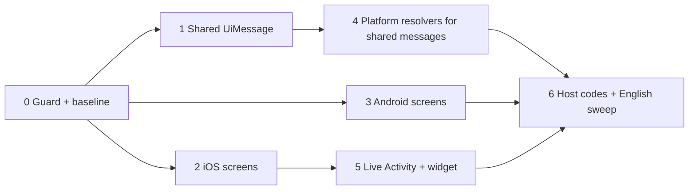

# Full i18n support — plan

Goal: with English selected, no Chinese appears anywhere the app controls — screens, errors, notifications, Live Activity, widget — on iOS and Android, and new hardcoded Chinese cannot be merged again.

Done check: the leak scanner (Phase 0) reports zero unallowlisted literals, and an English walkthrough of the screens below shows no CJK text except user/host content.

Baseline inventory (file:line for every leak): produced by the Phase 0 scanner; first run found ~240 Android, ~100 shared KMP, ~550 iOS literals (part of iOS is developer diagnostics and previews).

## Root causes

| Cause | Where | Effect |
| --- | --- | --- |
| Shared KMP emits finished Chinese sentences | `shared/.../facade/*Store.kt` (`fail(message: String)`, `error: String?`), `AssistantStreamState.kt`, `GatewayWireDecoder.kt`, `GatewayProfile.kt`, `GatewayProtocol.kt`, `ToolActivitySummary.kt` | Both apps show Chinese unless the UI happens to re-translate the exact string |
| iOS renders `String` values with `Text(value)` (verbatim) | `AppStore.swift` progress/notice/error fields, `GatewayModels.swift`, `ConversationView.swift` (tool labels, goals, modes, thinking phrases), `GatewayClient.swift`, `MultiGatewayStore.swift` | Catalog never consulted |
| iOS literal keys missing from `Localizable.xcstrings` | `RootView.swift` scheduled tasks, `PluginsView.swift`, `LogExportView.swift`, several `String(localized:)` in `AppStore.swift`/`ConversationView.swift` | Falls back to the Chinese key |
| Android text bypasses `appText` or misses the map | `ScheduledTasksScreen.kt`, `AndroidSharedStateHolder.kt`, `ConversationScreen.kt`, `PluginsScreen.kt`, `TailscaleTunnelScreen.kt`, `TeamUi.kt` | Falls back to the Chinese key |
| Widget extension has no catalog and cannot see the in-app language | `AgentLiveActivityWidget/`, status strings built in `AgentLiveActivityManager.swift` | Lock screen / Dynamic Island always Chinese |
| Logic compares display text | `AppStore.swift:166` (`case "写入"`), `ConversationView.swift:944` (`contains("尚未缓存")`), `ToolActivityLabels.kt:6` (regex on `替换 … 行`) | Translating the producer silently breaks behavior; must be fixed before or with the producer |
| Host-provided messages (`frame.message ?: "…"`) | many call sites | Chinese from the host passes through; client can only map known `code`s |

## Decisions

1. **Shared code returns message IDs, not text.** Introduce in `shared/commonMain`:
   ```kotlin
   data class UiMessage(val key: String, val args: List<String> = emptyList())
   ```
   Every `error: String?` / `fail(message: String)` / exception message that reaches UI becomes `UiMessage`. Keys are semantic (`voice.mic.permission-denied`), matching the existing semantic keys (`storage.cleaned`, `command.running`). Host passthrough keeps a dedicated variant (`UiMessage.raw(text)`) so it is explicit, not accidental.
   Rejected: keep Chinese sentences as keys in shared — interpolated sentences (`缺少必填字段 …`, `替换 N → M 行`) cannot be looked up, and it keeps display text coupled to logic.
2. **Platform code keeps its current key style.** Static UI strings stay Chinese-source-keyed (`Text("创建任务")`, `appText("创建任务")`); no mass key rename. New dynamic or interpolated strings use semantic keys.
3. **One translation source per platform, resolved at the render boundary.** iOS: `Localizable.xcstrings`. Android: `AndroidStrings.english` map. Each platform gets one `resolve(UiMessage)` function; views never receive pre-built Chinese sentences.
4. **Widget gets text from the app, in the app's language.** No App Group entitlement exists, so the widget cannot read the in-app language. `AgentLiveActivityManager` already fills `ContentState.status/detail/secondaryDetail`; it will build them with `String(localized:)`, and the widget's own chrome labels (`详情`, `查看详情`, `检查结果`, phase badges) move into a small `labels` struct inside `ContentState`/`Attributes` populated by the app. Widget code keeps no user-facing literals except previews.
5. **Developer diagnostics are not translated.** KMP bridge invariant errors in `KMPSharedAdapter.swift`, `appPrint`/`LocalAppLog` messages and `#Preview` data move to English text (they appear in logs and, rarely, in `lastError`), and are allowlisted by the scanner as diagnostics.

## Phases



### Phase 0 — guard
- Extend the existing `scripts/verify-localizations.py`: a comment-aware lexer scans `.swift`/`.kt` under `DeepSeekHarnessMobile/`, `AgentLiveActivityWidget/`, `androidApp/src/main/` and `shared/src/*Main/` and flags any Chinese string literal that is not (a) an argument of an iOS localizing API (`String(localized:)`, `Text(`, `Button(`, `.navigationTitle(` …) whose key has an `en` entry in `Localizable.xcstrings`, (b) inside `appText(...)` / `appTextKey(...)` with an entry in `AndroidStrings`, or (c) on a line marked `// i18n-ignore: <reason>` (regexes, legacy-data matchers, zh-only formats inside a zh branch). `--platform ios|widget|android|shared` scopes the scan.
- `appTextKey("中文")` (Android) marks a key stored now and resolved later with `appText(value)`; the verifier checks it like `appText`.
- Enforcement: Gradle `:androidApp:verifyLocalizations` runs before every Android unit-test task; the iOS CI workflow runs the script before building.
- No baseline file: the scan stays red until the phases below are done.

### Phase 1 — shared `UiMessage`
- Add `UiMessage` and convert, store by store: `SharedVoiceInputStore`, `SharedFileUploadStore`, `SharedQueueStore`, `SharedSessionAgentPresetStore`, `SharedTeamStore`, `VoiceInputProtocol`, `AssistantStreamState`, `GatewayWireDecoder`, `GatewayProfile`, `GatewayRuntime`, `GatewayProtocol` (`GatewayPairingPayloadException` carries a `UiMessage`).
- `ToolActivitySummary`: replace `label: String` with `kind: ToolActivityKind` (write/edit/read/exec/search/list/fetch/other) and `annotation` with typed fields (`lineCount`, `replacedLines`/`replacementLines`). Deletes the display-text comparisons in `AppStore.swift:166` and `ToolActivityLabels.kt`.
- `SharedVoiceInputStore.hint`/`status` become `UiMessage` too.
- Update `shared/commonTest` assertions to keys, not Chinese text.
- Exit: no CJK literal in `shared/src/commonMain` outside the allowlist.

### Phase 2 — iOS screens
- Add the missing catalog keys (scheduled tasks in `RootView.swift`, `PluginsView.swift`, `LogExportView.swift`, `ConversationView.swift` save/quote/goal strings, `AppStore.swift` `String(localized:)` calls without entries).
- Convert verbatim-rendered `String` producers to `String(localized:)` at creation: activity progress (`AppStore.swift:39-170`, `4893-4896`), plugin/schedule notices and errors (`AppStore.swift:1550-3350`, `4933-4945`), `GatewayModels.swift` plugin status/runtime names, `ConversationView.swift` agent mode blurbs, goal labels, queue action labels, thinking phrases, `GatewayClient.swift`/`MultiGatewayStore.swift`/`GatewayProfile.swift` errors, `VoiceInputAdapter.swift` capture errors.
- Replace `error.contains("尚未缓存")` with a typed history-error case.
- Exit: scanner clean for `DeepSeekHarnessMobile/` except diagnostics allowlist.

### Phase 3 — Android screens
- `ScheduledTasksScreen.kt`: wrap every `Text("…")`, dialog, label and validation string in `appText`; add map entries.
- `AndroidSharedStateHolder.kt`, `AndroidGatewayProjection.kt:451,545`, `ConversationScreen.kt:583-587`, `PluginsScreen.kt:316-333`, `DshSelectionToolbar.kt:60`, `DshTableTextSelectionPage.kt:93`, `TailscaleTunnelScreen.kt`, `TeamUi.kt:379`, `NetworkDiagnosticsPanel.kt` interpolations, `PendingFileCard.kt`, `AndroidFileUploadController.kt`: route through `appText`, add the ten missing map entries and the rest.
- Exit: scanner clean for `androidApp/src/main/`.

### Phase 4 — resolve shared messages on each platform
- iOS: `extension UiMessage { var localized: String }` using `String(localized: String.LocalizationValue(key))` + `String(format:)` for args; Android: `appText(message)` overload. Add `en` and `zh-Hans` entries for every Phase 1 key in both catalogs.
- Every view showing a shared error/hint/status calls the resolver (e.g. `ConversationView.swift:1640`, `PendingFileCard.kt:57`, `VoiceRipplePanel.swift:55`).
- Exit: switching language in Settings changes voice, upload, queue, mode, pairing and tool-row text on both apps.

### Phase 5 — Live Activity and widget
- `AgentLiveActivityManager.swift`: build `status/detail/secondaryDetail` with `String(localized:)`; add catalog entries.
- Add a `labels` payload to `ContentState` (chrome strings + phase badge texts) filled by the app; widget renders only payload text. Keep a decode default so activities started by an older build still render.
- Notifications (`AgentUserNotificationManager.swift`) already use keyed strings — verify only.
- Exit: Live Activity lock-screen and Dynamic Island previews show English with app language English while the device language is Chinese.

### Phase 6 — host messages and final sweep
- Map known host error `code`s to local keys before falling back to `frame.message` (plugins, schedules, uploads, presets, history). Unknown codes pass through as `UiMessage.raw`.
- File a host-side ticket: send `code` on every error frame, or honor a client `locale` on connect.
- Verifier clean across all platforms; it now fails on any new leak.
- English walkthrough on both apps with screenshots: onboarding/pairing, session list, conversation (tools, thinking, queue, quote, images), voice input, file upload, scheduled tasks (list, create, history), plugins (list, update), settings (storage, logs, network diagnostics, Tailscale), Live Activity.

## Risks
- **Tests pinned to Chinese text** (Android device tests, `GatewayProtocolTests`, `shared/commonTest`) break when producers change; update them to keys or to English under a fixed locale in the same phase.
- **Interpolation order:** English templates must use positional args (`%1$@`, `%1$s`); the Android resolver already supports reordering.
- **Language switch timing on iOS:** `AppLanguage.apply` writes `AppleLanguages`; strings resolved and cached before relaunch stay in the old language. Resolving at render (Phase 4) limits this to already-built state; confirm whether Settings prompts for relaunch.
- **Two hand-maintained catalogs drift.** Optional follow-up: generate the Android `english` map from `Localizable.xcstrings` at build time so each string is translated once.
