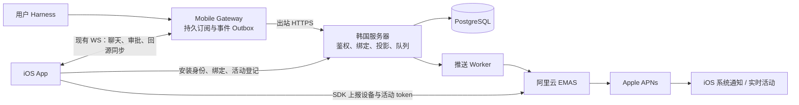

# iOS 统一推送与实时活动接入方案

日期：2026-11-13。状态：原始自建服务方案，已由 [无状态云函数方案](ios-stateless-push-plan.md) 替代为当前方向。本文保留代码调研、SDK 接口和兼容性分析作为参考；其中韩国服务器、PostgreSQL、常驻 Worker 和云端业务状态表不再属于当前实施范围。本文不代表已部署或已验证容量。

## 1. 目标与实施结论

采用「韩国服务器上的轻量推送业务服务 + 阿里云 EMAS 移动推送 + Apple APNs」。用户的 Harness 和 Agent 继续运行在用户主机；统一服务器只处理通知授权、订阅和状态摘要，不代理聊天、模型调用、文件或设备工具。

首版交付：

- 完成、失败、等待审批、等待回答四类普通远程通知。
- 用户在手机启动的实时活动，在 App 挂起或 Gateway WebSocket 断开后仍能收到远程状态更新。
- 通知点击后切换到正确的 Gateway 和会话，重新同步权威状态。
- 多用户、多主机、多设备的授权隔离、解绑、重试、限流及诊断。

第二阶段再接入 iOS 17.2+ 远程启动实时活动，用于定时任务、桌面端发起的任务；首版没有活动时仍发送普通关键通知。首版不实现通过统一服务器执行审批、回答或其他命令。

「离线」指 App 不在线但手机能访问 APNs。手机断网、主机关机和系统推送限制均不能由本方案消除；推送不是完整事件日志，打开 App 必须回源同步。

## 2. 阶段 0：已核对的代码和文档

### 2.1 当前代码入口

| 位置 | 当前行为 | 改造方向 |
| --- | --- | --- |
| `DeepSeekHarnessMobile/App/DeepSeekHarnessMobileApp.swift` | 已有 UIApplicationDelegate，初始化通知管理器 | 增加 SDK 生命周期、APNs 注册回调；保持一个通知中心 delegate |
| `DeepSeekHarnessMobile/Core/AgentUserNotificationManager.swift` | 网关事件驱动本地通知，`userInfo.gatewayID` 实际为本地主机资料 ID | 增加远程通知解析、去重和云端身份到本地资料映射 |
| `DeepSeekHarnessMobile/Core/GatewayProfile.swift` | `id`、`gatewayId`、`remoteDeviceId` 是不同身份 | 不把本地主机资料 UUID 用作云端网关身份 |
| `DeepSeekHarnessMobile/Core/MultiGatewayStore.swift`、`Views/RootView.swift` | 主机切换、通知路由和审批依赖当前 AppStore | 先恢复主机资料，再切换、连接、校验会话、导航 |
| `DeepSeekHarnessMobile/LiveActivity/AgentLiveActivityManager.swift` | `pushType: nil`；本地更新缓存；完成后有 30 秒宽限 | 获取活动 token；增加远程管理状态，协调写入和结束 |
| `DeepSeekHarnessMobile/LiveActivity/AgentActivityAttributes.swift` | 主 App 与 Widget 共用 Codable 状态，包含 Date 和本地化 labels | 定义版本化推送状态和跨语言编码夹具 |
| `DeepSeekHarnessMobile/Resources/Sharing.entitlements`、`Info.plist` | 尚无 APNs entitlement；已有实时活动声明 | 增加推送签名能力，保留现有能力 |
| `shared/.../gateway/GatewayProtocol.kt`、`protocol/GatewayDtos.kt` | 共享网关协议 | 增加能力协商和推送绑定协议 DTO，不加入阿里云 SDK |

网关仓库：`../dsh-plugin-mobile-gateway`。

- `lib/index.mjs` 的 `session/event` 监听在无客户端时提前返回；推送投影入口必须位于该判断之前并独立于广播。
- `lib/session-follower.mjs` 的实例由 WebSocket 连接持有，不能直接用作持久推送订阅。需要助手摘要时单独维护按会话合并的后台 follower。
- `lib/devices.js` 已实现配对设备注册和撤销，可以复用已认证设备身份；不能把当前网关访问 token 上传到统一服务器。
- 无交互客户端时，审批和提问可能执行 `fallbackApproval` / `fallbackQuestion`。必须新增明确的移动推送等待策略。

### 2.2 允许使用的官方 API

| 用途 | 已核对 API / 参数 | 来源 |
| --- | --- | --- |
| SDK 初始化与设备身份 | 官方 Swift 示例：`CloudPushSDK.start(withAppkey:appSecret:) { ... }`、`getDeviceId()`、`registerDevice(deviceToken) { ... }` | [iOS SDK 集成](https://help.aliyun.com/zh/document_detail/434691.html)；实施时以下载 SDK 头文件及 Swift 导入接口为准 |
| 活动更新 token 上报 | `registerLiveActivityPushToken:forActivityId:withCallback:` | [灵动岛管理接口](https://help.aliyun.com/zh/document_detail/2871404.html) |
| 活动状态上报 | `syncLiveActivityState:forActivityId:withCallback:` | 同上；状态值 `active / ended / dismissed / stale` |
| 远程启动 token 上报 | `registerLiveActivityStartToken:forActivityAttributes:withCallback:` | 同上；第二阶段使用 |
| 服务端实时活动推送 | `Push` 的 `iOSLiveActivityEvent / Id / AttributesType / Attributes / ContentState / StaleDate / DismissalDate` 以及 `iOSApnsEnv` | [Push 接口](https://help.aliyun.com/zh/document_detail/2249916.html) |
| 阿里云 APNs 凭证 | Team ID、Key ID、P8；实时活动要求 P8 | [APNs 鉴权配置](https://help.aliyun.com/zh/document_detail/434644.html) |
| 活动注册、恢复 | `.token`、`pushTokenUpdates`、`activityStateUpdates`、`Activity.activities`；远程启动阶段加 `pushToStartTokenUpdates`、`activityUpdates` | [Apple 推送指南](https://developer.apple.com/documentation/activitykit/starting-and-updating-live-activities-with-activitykit-push-notifications) |

不假定存在官方 Swift Package；首选官方 XCFramework 集成并固定版本。当前工程使用 Swift 5.10，阿里云集成页声明支持 Swift 5.x，首轮必须验证设备和模拟器构建。不要照抄文档示例替换整个 AppDelegate。

## 3. 系统结构与职责



| 组件 | 必须提供的能力 |
| --- | --- |
| 韩国服务器 | HTTPS 接口、安装/网关身份、绑定授权、订阅管理、事件验签、去重、版本控制、摘要渲染、持久队列、阿里云适配、统计和解绑 |
| Gateway | 独立于手机连接监听事件、持久推送订阅、可信设备授权、事件序号与 Outbox、关键状态投影、断点重试、撤销同步 |
| iOS | EMAS SDK / APNs 注册、设备绑定、通知路由、Activity token 与状态上报、通知偏好、恢复与本地/远程协调 |
| 阿里云 | 设备和 token 映射、普通通知及实时活动下发、平台记录和错误信息 |
| Apple | 系统投递与展示；实际到达时间由设备网络、权限和系统策略共同决定 |

韩国服务器不需要能主动连接用户的局域网 Gateway，Gateway 主动向公网 HTTPS 接口上报即可。不得开放任意目标、任意内容的匿名推送 API。

## 4. 身份与绑定设计

### 4.1 身份字段

| 字段 | 含义 |
| --- | --- |
| `installationID` | 本次 App 安装的推送身份，私钥/凭证保存在 Keychain；重装和设备 ID 改变时重新核验 |
| `localProfileID` | 当前 `GatewayProfile.id`，只在手机内使用 |
| `gatewayID` | 当前 `GatewayProfile.gatewayId`，主机的稳定身份 |
| `relayGatewayID` | 统一服务器登记的网关身份，绑定稳定 gatewayID 和网关公钥，隔离不同运营空间 |
| `pairedDeviceID` | Gateway 配对设备注册表中的 ID，对应 `remoteDeviceId` |
| `providerDeviceID` | EMAS SDK `getDeviceId()` 的结果，限定到 AppKey 和环境 |
| `bindingID` | 服务端生成的 installation 与 relayGateway、pairedDevice 的授权关系 |
| `sessionID / runID / eventID / stateVersion` | 会话、一次执行、原始业务事件、可比较的状态版本；session 内保持顺序 |
| `activityID / activityGeneration` | ActivityKit 实例及当前登记代次，用于防止结束和更新旧实例 |

Gateway 不得指定 `providerDeviceID` 或活动 token；只能提交本租户的会话事件，由服务器按已授权的 binding 展开接收者。会话 ID 不是授权凭证。

### 4.2 首版授权流程（邀请测试，无需先建设完整账号系统）

1. 管理员生成限次、限期邀请。Gateway 本地生成签名密钥，通过邀请在服务端激活，得到 relayGatewayID；统一服务器保存公钥和授权范围。
2. 手机通过现有配对完成认证。Gateway 向统一服务器签名申请一次性绑定 grant，绑定 gatewayID、pairedDeviceID、手机安装公钥和过期时间，再通过当前认证 WS 返回手机。
3. 手机使用 grant 登记安装身份和 providerDeviceID。服务端必须校验安装公钥持有证明，并通过面向该 providerDeviceID 的一次性验证推送校验投递目标所有权；不能仅凭客户端提交的 ID 成为正式接收端。
4. 手机前台接收验证推送，仅处理与本机待登记 requestID 匹配的 nonce，签名回传后激活 binding。验证消息按请求来源限流，超时失效；通知未授权或验证失败时显示未启用，不能假报成功。
5. 安装凭证只允许维护自身设备、binding 和活动；Gateway 凭证只允许操作自身网关的绑定、事件和撤销。私钥持有证明绑定请求方法、路径、body 哈希、时间和一次性 nonce，具体签名规范在阶段 0 固化。
6. 手机删除主机或关闭推送时直接撤销云端 binding；主机撤销配对设备时通过 Outbox 同步撤销。断网撤销保留待办，界面说明尚未完成云端解绑。worker 发送前再次检查有效性；已交给 APNs 的消息无法保证撤回。

面向公开用户开放前补齐自助注册、恢复和防滥用审核；不能把一个全局服务密钥放进开源 Gateway。邀请绑定、投递验证和配对认证均不替代用户对云端处理摘要的同意。

## 5. 韩国服务器的实现

### 5.1 技术与部署

- 初始使用已检查的 2 vCPU、约 4GB 内存、60GB 磁盘主机；当前余量适合测试，不作容量保证。部署前确认现有端口、服务和带宽，不覆盖其他业务。
- 建议独立项目 `dsh-push-relay`：TypeScript + Node.js LTS、HTTPS 框架、PostgreSQL、阿里云服务端 SDK。Node 精确版本和依赖版本在实施阶段锁定。
- Docker Compose 部署 HTTPS 反代、API、worker、PostgreSQL；API 与 worker 可共用镜像。初期数据库队列足够，无需 Redis/Kafka。
- 域名如 `push.<自有域名>`，只开放 443；数据库监听容器私网；配置健康检查、自动重启、数据库迁移、仓库外凭证及加密备份。
- 公网访问 `cloudpush.aliyuncs.com`；从韩国验证 TLS 和实际 API 延迟，不用电脑到主机的 ping 代替服务链路验收。[接入点](https://help.aliyun.com/zh/document_detail/2249911.html)

### 5.2 数据与队列

最小数据表：`installations`、`relay_gateways`、`bindings`、`session_subscriptions`、`live_activities`、`session_states`、`incoming_events`、`push_jobs`、`delivery_attempts`、`consumed_nonces`。

- 事务中先落事件、更新状态、生成 jobs，成功提交后才返回受理；用唯一键去重，不仅在内存做缓存。
- 唯一业务事件键包含 relayGatewayID、sessionID、eventID；状态有持久化的 session 版本和 runID，服务重启不能归零。
- 投递任务按接收设备、事件和通道去重；实时活动进度按 activityGeneration 合并，只保留最新待发快照。
- worker 使用数据库租约领取任务，带租约超时和崩溃恢复；发送前检查 binding、活动代次、截止时间和最新状态。
- 对阿里云暂时错误和限流做退避重试；参数、凭证、设备无效分别处理。请求超时可能已经受理，属于至少一次投递，不能承诺普通通知严格只出现一次。
- 初始保留：结构化投递诊断 7 天、已完成事件/jobs 7 天；过期活动清理，绑定保留到撤销；长期只留聚合指标。所有期限可配置，不能保存完整聊天轨迹。

### 5.3 拟新增接口

以下是本方案定义的新接口，不是现有工程或阿里云现成接口。

| 接口 | 调用方 | 用途 |
| --- | --- | --- |
| `POST /v1/gateways/enroll` | Gateway | 消耗邀请登记公钥与稳定身份 |
| `POST /v1/gateways/me/binding-grants` | Gateway | 为已配对设备申请安装绑定 grant |
| `POST /v1/installations/enroll`、`POST /v1/installations/verify` | 手机 | 持有证明、投递目标验证、登记 |
| `PUT /v1/installations/me` | 手机 | 更新设备 ID、schema 版本、语言、权限和频繁更新偏好 |
| `PUT /v1/bindings/{id}/subscriptions/{sessionID}` | 手机 | 开启/关闭会话通知与活动跟踪 |
| `PUT /v1/bindings/{id}/activities/{activityID}` | 手机 | SDK 上报成功后登记活动代次、关联 session、schema 与准备状态 |
| `DELETE /v1/bindings/{id}/activities/{activityID}` | 手机 | 活动已结束或用户移除，停止下发 |
| `POST /v1/gateways/me/events` | Gateway | 批量上报标准化业务事件，返回逐条持久化受理结果 |
| `DELETE /v1/bindings/{id}` | 手机/Gateway | 按授权范围撤销推送绑定 |
| `GET /v1/installations/me/status` | 手机 | 接入状态和可解释诊断，不暴露密钥 |
| `GET /healthz`、`GET /readyz` | 运维 | 进程及数据库可用性；详细指标仅内网访问 |

活动登记和订阅修改使用单调递增的 `registrationVersion`，拒绝延迟到达的旧登记；API 使用 schemaVersion，支持旧客户端能力降级。

### 5.4 事件协议和推送策略

标准事件示意（字段为拟新增协议）：

```json
{
  "schemaVersion": 1,
  "eventID": "host-event-id",
  "gatewayID": "stable-gateway-id",
  "sessionID": "session-id",
  "runID": "run-id",
  "stateVersion": 128,
  "occurredAtUnixMs": 1794531600000,
  "kind": "approval.required",
  "state": {
    "phase": "awaitingApproval",
    "requestID": "request-id",
    "summaryKey": "approvalRequired",
    "summaryArgs": {}
  }
}
```

- 统一服务核对 gatewayID 与签名身份一致；不接受任意原始 APNs payload、任意点击 URL 和可执行命令。
- 默认只发送阶段、结果和必要路由标识。会话标题、工具名可由用户选择开放；命令全文、文件内容、提问正文默认不上传，避免把当前本地通知的详细内容直接搬到云端。
- 只订阅用户明确跟踪的会话；默认开启手机发起任务的跟踪，不默认推送整台主机所有会话。未来增加定时任务和桌面任务订阅选项。
- 普通通知只发四类关键事件；运行进度在 10 秒窗口合并，有变化才发。需要时可发低频新鲜度快照，不能伪装离线主机仍在工作。
- 默认普通通知承担声音/横幅，活动更新不携带额外 alert，避免同一审批双重提醒。活动低优先级发送；优先级字段需从所选阿里云 API/SDK 真实模型验证，不能把原生 APNs header 当成不存在的 API 参数。
- 通知 TTL：运行进度 60 秒，审批/问题不晚于请求到期，完成/失败建议 24 小时；业务状态已失效时丢弃旧 job。
- 服务端保留重试期限和过期策略；真实发生的延迟必须可见。阿里云受理、APNs 受理、设备展示、用户点击是不同指标。

## 6. Gateway 插件改造

新增独立模块：`push-relay-client.mjs`、`push-subscriptions.mjs`、`push-event-projector.mjs`、`push-outbox.mjs`，避免继续扩大 `lib/index.mjs`。

1. 增加能力协商，如 `pushRelay.v1`，返回 relayGatewayID、公钥指纹与绑定支持状态；版本号在完成发布时统一确定，不预先猜最低插件版本。
2. 复用配对设备认证处理订阅与 grant，不能接受客户端自行提交其他配对设备 ID。
3. 在宿主 session/event、审批/提问请求和解决事件入口产生标准状态，无客户端时仍写入 Outbox；标题变更、重命名、取消也需更新订阅状态。
4. Outbox 持久化，网络恢复后按同一序号重试；普通进度可合并，关键事件不能被进度淘汰。Outbox 写失败必须报告接入降级，不阻塞 Agent 执行。
5. 网关重启恢复订阅并从宿主权威快照对账；不能依靠旧 WebSocket 连接恢复。确实无法恢复的待审批/提问标记失效，不伪造为继续等待。
6. 审批默认等待期限建议 15 分钟，可配置；宿主原有取消、拒绝与更短期限优先。没有 WS、但存在有效移动推送订阅时，不能仅因没有交互客户端立即 fallback；到期走现有取消/回退语义，绝不自动批准。
7. 桌面端处理审批/问题后仍广播解决状态并通知 relay 更新活动，手机回来时重新校验，不重复处理。
8. 凭证撤销、网关关闭、会话归档/删除、订阅关闭时同步清理。长时间无法同步撤销时，云端 binding 依靠续租到期停发；初始租期建议 24 小时、小时级续租，具体值可配置。

最小实现优先使用持久宿主事件做“正在执行/完成/等待”摘要；逐步接入工具阶段，不转发每个 assistant chunk。

## 7. iOS 客户端改造

### 7.1 SDK 和 APNs

- 新增 `IOSPushProvider` 协议、`AliyunPushProvider` 适配器和 `PushRelayClient`，业务层不直接调用第三方 SDK。
- 在合适的功能启用时说明云端处理范围并申请权限；SDK 初始化、网络上报遵循用户选择和项目隐私声明。
- 使用已有 AppDelegate：初始化 SDK、`registerForRemoteNotifications()`、实现成功/失败回调；成功时把 APNs deviceToken 交给 `CloudPushSDK.registerDevice`，SDK 提供 providerDeviceID。
- 保留一个 `UNUserNotificationCenterDelegate`，集中转发 SDK 统计、注册验证、通知路由。SDK 回调切回所需 actor；不替换 SwiftUI 的场景配置。
- `aps-environment` 必须与签名 profile 匹配；development、production、Bundle ID、EMAS AppKey 明确隔离，禁止仅凭是否 DEBUG 判定所有分发环境。
- 普通 alert 和 ActivityKit 远程更新不依赖 `remote-notification` 后台模式；只有引入真实的静默内容刷新需求时才增加，不为保活而添加。

### 7.2 实时活动

1. 未启用云端推送时保留本地模式；启用且具备签名能力时使用 `.token` 创建活动。
2. 监听 `pushTokenUpdates`，先调用阿里云更新 token 注册 API，成功后向 relay 登记 activityID、generation、session 和 schema；relay 持久化确认后才进入 `remoteManaged`。
3. 以 `localOnly → registering → remoteManaged → ended/dismissed` 管理状态；登记迟到时先推送服务端最新快照，不回放历史进度。
4. 远程管理后，常规进度和结束由 relay 负责；本地 Widget 操作只提交意图，不把“点击”当作宿主已确认。不得让本地 AppStore 重放旧事件覆盖新的远程状态。
5. 监听活动内容/状态变更，合并远程最新内容到本地缓存；回前台先读取 ActivityKit 当前 content、再与 Gateway 最新版本对账。需要本地修复时先暂停云端发送并完成所有权交接，不能超时就自动启用双写。
6. 现有 30 秒结束宽限在远程模式交由 relay 维护：终态先 update，宽限后 end；新 run 到达则取消同代次旧 end。结束任务发送前核对 runID、generation 和最新版本。首版超过 8 小时不自动重建，继续发普通通知。
7. App 冷启动枚举并恢复所有仍有效活动的监听；保留现有“只显示当前一个会话”的产品行为，新活动登记时撤销旧活动发送目标，重建活动产生新 generation。
8. `activityStateUpdates` 同步给阿里云及 relay；用户移除后停止该实例推送，不自动强行重建。状态登记失败和 token 轮换持久重试，但不得延长系统活动寿命。

### 7.3 状态编码与版本兼容

首版保持现有界面，通过 `contentSchemaVersion` 选择服务端 renderer；给 ContentState 增加可选 `runID/stateVersion`，老版本可解码。现存 ActivityAttributes.gatewayID 也使用 localProfileID，首版继续保持该语义，云端通过活动登记关联稳定身份；不能只修普通通知路由而遗漏 Widget 的链接和 Intent 参数。

- `phase/status/updatedAt` 等必需字段必须完整；optional 和 labels 缺省行为用夹具验证。服务端维护中英文短文案，按安装语言生成，避免依赖手机运行来补全 labels。
- 现有 Date 使用 Swift 默认 Codable 时以 2001 年参考时间编码；原生 APNs `timestamp/stale-date/dismissal-date` 使用 Unix 秒。二者不能混用。已用本机 Foundation 验证 Unix 时间 0 的默认编码为 `-978307200`；服务端 ContentState Date 转换为 `unixSeconds - 978307200`。第一轮直接用 Swift 默认编码产出金样例，再用服务端生成相同 JSON 并由 Swift 解码；不能给 ActivityKit 指定它不认识的 ISO8601 策略。
- 阿里云是否生成 timestamp、其同秒更新顺序和原生日期字段映射必须实测；同一活动串行发送、秒级以内合并，发现旧版本不可靠时暂停本地/远程双写，而不是虚构可传入的时间戳参数。
- 限制静态属性与动态状态总量，并对最终 APNs payload 按 UTF-8 字节检测；保守目标不超过 3KB，长摘要裁剪，Unicode 正确处理。具体系统约束见 [Apple 活动指南](https://developer.apple.com/documentation/activitykit/displaying-live-data-with-live-activities)。

### 7.4 通知跳转、去重和设置

- 远程 userInfo 使用 `relayGatewayID/gatewayID/sessionID/eventID`；通过 binding 和 GatewayProfile.gatewayId 解析 localProfileID，再复用现有路由。兼容旧本地通知 `gatewayID=localProfileID`，不要改变旧 payload 的解释。
- 冷启动等待 MultiGatewayStore 完成恢复；切换正确主机、完成连接及会话校验后再导航。主机已删除或请求已失效时明确反馈，不自动新建主机或执行操作。
- 当某 binding 已确认由远程通知负责时，停止该范围的本地关键提醒，前台远程通知仍按当前策略抑制横幅。旧 Gateway/未启用推送保留本地模式；不依赖“WS 在线”决定是否发送。
- 平台超时重试和历史重放使用同一 eventID；不以 collapseID 宣称通知严格去重。离线后恢复以最新服务端快照为准。
- 设置新增：云端推送总开关、每主机/会话订阅、普通通知/实时活动分开控制、标题摘要隐私选项、接入状态、测试通知；默认不扩大到整个主机所有任务。
- 首版审批按钮断线时引导打开 App 重连；暂不接入 relay 审批写接口。不能只显示“提交成功”而未收到宿主确认。

## 8. 阿里云和 Apple 接入步骤

1. Apple Developer 中确认正式主 App Bundle ID、Push Notifications 能力和签名 profile；扩展 Bundle ID 不是推送主 topic。
2. EMAS 新建专用 iOS 应用，配置匹配的 Bundle ID。记录客户端 AppKey/AppSecret，开发测试与正式环境的配置映射独立保存。
3. 使用 APNs P8 鉴权，上传 P8、Team ID、Key ID；按 [官方鉴权配置](https://help.aliyun.com/zh/document_detail/434644.html) 的当前要求选择密钥环境，发送控制台测试。
4. SDK 接入按 [iOS 集成文档](https://help.aliyun.com/zh/document_detail/434691.html) 执行，锁定 XCFramework 版本及依赖；完整真机/模拟器构建后再接业务。
5. 云服务使用专用 RAM 身份和最小推送权限，生产 AccessKey 仅存服务端，优先支持可轮换短期凭证。韩国第三方云主机不能假设自动获得阿里云实例角色凭证。
6. 首版 provider 适配固定使用已有明确实时活动字段的 `Push` API，普通通知 `PushType=NOTICE`、`DeviceType=iOS`、`Target=DEVICE`，目标为 EMAS DeviceID；`iOSApnsEnv=DEV/PRODUCT`，TestFlight 和 App Store 使用 PRODUCT。设置标题正文、受控扩展字段。`iOSExtParameters` 为 JSON 字符串，路由实际落在 userInfo 的位置用真机夹具确定。
7. 实时活动按该 API 的 LiveActivity 字段构造 update/end；ContentState 和 Attributes 按接口要求 JSON 序列化，不能重复编码。SDK 注册成功不等于服务端绑定成功，两步分别记录。
8. 如改用 PushV2，必须先核对官方 `PushTask` 结构和 SDK 模型，再替换适配器；不混用两套参数。[PushV2 指南](https://help.aliyun.com/zh/document_detail/2986583.html)
9. 用一台开发真机完成普通通知和活动 update/end，再用 TestFlight 验证 production。查看 EMAS 推送记录、业务 traceID 和次日计量。

凭证区分：SDK 初始化所需 AppKey/AppSecret 按官方方式进入客户端，它们不能作为你的业务 API 授权；RAM AccessKey/Secret 与 APNs P8 私钥不得进入手机、Gateway 分发包、仓库或日志。API 日志脱敏 providerDeviceID、token 和正文。

## 9. 第二阶段：远程启动活动

- iOS 17.2+ 监听启动 token 并通过 `registerLiveActivityStartToken` 注册；冷启动/后台启动枚举活动，监听新活动并注册更新 token。
- 远程 start 使用 `AgentActivityAttributes` 的真实类型名、静态属性、初始 ContentState 和 Apple 要求的提示；先核对 EMAS 为新活动分配/传入活动 ID 的规则，再打通“远程 start → 实例识别 → 更新登记”。不能假设自定义 ID 等于系统生成的 activity.id。
- 远程启动前定义带明确版本的稳定网关路由属性，更新 Widget 链接、Intent、恢复与 manager key 映射；旧活动保留 localProfileID 路由。不能给现有 attributes.gatewayID 填入稳定 ID 后，仍交给按本地 UUID 匹配的旧代码处理。
- 对每个 installation 限制当前受跟踪会话和待启动状态，避免重复创建或多主机争抢；用户关闭活动/频繁更新权限时降级普通通知。
- 未收到更新 token 时保留最新状态、超时诊断，不假定远程启动后立即可更新。清理已过期启动登记，token 有变化就更新。
- 覆盖定时任务、桌面端任务的明确订阅；不默认向所有绑定设备远程启动活动。

## 10. 实施阶段、验收与防错

| 阶段 | 实施范围与依据 | 验收标准 | 防错要求 |
| --- | --- | --- | --- |
| 0：技术探针 | 复制官方 SDK 初始化、token 注册、Push update/end 示例，产出 Swift/服务端编码夹具；对照第 2 节 API | 开发及 TestFlight 真机通知成功，挂起后活动更新/结束成功；确认签名、参数、计量、payload 限制 | 不先建设完整服务；不假设 SDK 方法/Swift bridge 名称存在 |
| 1：统一服务骨架 | 实现第 4、5 节注册、授权、表结构、队列、RAM 适配；独立仓库与 staging | 两个租户不能越权；重放、假 deviceID、grant 复用失败；worker 崩溃恢复不丢关键 job | 不开放匿名任意推送，不泄露密钥，不把受理当送达 |
| 2：Gateway 上报 | 复用第 2 节宿主监听/registry 认证；增加 Outbox、订阅、撤销与等待策略 | 零 WS 客户端仍上报；网络失败/重启恢复；桌面处理和请求到期可清理 | 不用连接级 follower 代替持久订阅，不因离线自动批准 |
| 3：iOS 普通通知 | 复用现有通知中心和主机路由；完成 SDK、绑定、开关及本地模式切换 | 前后台/冷启动、多主机点击、解绑、拒绝权限、历史重放均正确 | 不增加第二个 delegate，不混用本地 ID 与稳定 ID |
| 4：已有活动远程管理 | 按第 7 节 token 上报、generation、恢复和状态协议实施 | 挂起/终止场景分别实测；无 WS 时更新；旧事件不回退；旧 end 不结束新 run | 不让前台重放和云推送双写竞争，不用静默推送作为主更新链路 |
| 5：远程启动 | 按第 9 节和 Apple start 示例实施 | 定时/桌面任务可按订阅启动并完成后续更新；旧系统降级 | 不假设 activityID 映射，不重复启动被用户移除的活动 |
| 6：发布验证 | 核对 SDK 真实签名、API schema、越权用例、通知/Widget UI 和系统边界 | 关键路径端到端通过，故障/备份恢复演练完成，灰度和回滚可用 | 不以测试框架成功替代真机验证，不宣称严格实时/仅一次投递 |

重点故障用例：阿里云超时但已受理、401/403、限流、无效设备、乱序、旧 run 迟到、日期错误、超长中文摘要、手机断网、主机离线、数据库重启、用户关闭通知、活动移除、配对撤销、语言切换、签名环境不匹配。

压测先用 mock provider 测业务队列和鉴权，再小流量验证真实接口，避免大量向真机发测试通知。初始负载档位 10/50/100 次事件每秒，记录合并后请求量、队列最老任务年龄、P95 服务处理耗时和失败率，不把档位当硬件容量承诺。

## 11. 运营、成本和回滚

- 当前公开规则为每 App 每月前 5 万去重设备免费，超出 0.06 元/台；实时活动共用该计费口径是根据接口和统一计费页推断，尚未有账号实账或工单明确确认。[计费规则](https://help.aliyun.com/zh/document_detail/434638.html)
- 阶段 0 做普通通知与多次活动更新对照，查看计费数量；上线前确认真实账号是否有额外约束。免费阈值不是调用 QPS 或到达 SLA。
- 指标包括月去重设备、每租户任务量、队列积压、provider 错误、活动注册失败、token 更新失败、过期丢弃、点击率；对“客户端已确认展示”只统计确实有回执的消息。
- 默认诊断告警：关键 job 等待超过 30 秒、provider 连续失败、磁盘/数据库容量异常和月设备额度接近预算；阈值按测试调整。
- 单机首版存在故障停发风险。定期异机加密备份并测试恢复；需要高可用时增加应用节点和独立高可用数据库，不能只加 CPU。
- 三层开关：服务端租户/全局发送开关、Gateway 上报开关、客户端通知/活动开关。provider 不可用时保留有 TTL 的待发任务，不阻塞 Agent 和聊天。
- 回滚远程活动前先停发、完成所有权交接；旧版本和未启用用户继续本地模式。不能在有未决远程投递时无条件启动本地重复提醒。

## 12. 实施前需要落实的配置

此处是后续实施输入，不影响当前方案评审：

- 正式域名、HTTPS 和韩国主机部署目录/端口；确认已有服务及资源余量。
- Apple 正式推送账号、Bundle ID 与可用的签名 profile。
- EMAS 应用、P8 鉴权、客户端配置和专用 RAM 推送身份；密钥通过安全配置注入，不在聊天粘贴。
- 首批测试设备、隐私默认值和邀请策略；初始方案采用邀请测试、仅订阅手机发起/明确跟踪的会话。
- 阿里云真实账号下的计量验证、SDK 构建兼容和活动 ID/日期映射探针结果。

下一步首先执行阶段 0，得到真实设备链路和编码证据；其后才进入服务与客户端完整实施。本次只新增方案文档，没有改业务代码、接入账号或部署远程服务。
