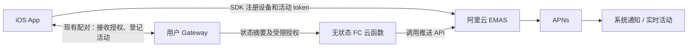

# iOS 无状态云函数推送方案

日期：2026-11-13。状态：架构方向已调整，待技术探针验证。

## 1. 核心约束

用户明确希望不提供常驻服务器，也不维护云端业务数据库、任务状态和订阅状态。

因此当前方案采用：Gateway 本地持有业务状态、阿里云 EMAS 托管推送设备和 token、FC 云函数校验受限授权后发送。无 PostgreSQL、Redis、业务队列或云端定时扫描。原 [方案](ios-aliyun-push-plan.md) 的源码分析和 SDK 接入资料仍可参考，自建服务器及集中状态部分不再实施。

## 2. 状态归属

| 状态 | 保存位置 |
| --- | --- |
| 已配对设备、用户推送偏好、会话订阅 | 用户 Gateway 本地持久配置 |
| runID、业务事件序号、最新进度 | 用户 Gateway 本地 |
| 待发事件、退避重试、结果记录 | Gateway 本地 Outbox；关键事件持久保存，进度合并 |
| 手机本地主机 ID 与稳定 gatewayID 映射 | iOS 本地资料 |
| ActivityKit token、push-to-start token 与设备映射 | 通过 SDK 上报 EMAS；手机恢复时再次同步 |
| 活动 ID、generation、状态版本和结束宽限 | Gateway 本地；手机登记并恢复对账 |
| 推送调用凭证、授权票据签名能力 | FC 托管身份/密钥配置；不分发给 Gateway |
| 供应商推送记录 | EMAS 控制台；不是自建的业务数据库 |

云函数不保存“当前哪个任务正在运行”，不连接用户 Gateway，不代理聊天或审批。内存缓存仅用于优化，不能作为权限和正确性的依据。[FC 无状态说明](https://help.aliyun.com/zh/functioncompute/configure-an-http-trigger-for-a-function-that-is-triggered-by-websocket-requests-1)

## 3. 云函数的最小职责

1. 接收 Gateway 的 HTTPS 请求，限制请求大小和允许的事件类型。
2. 校验授权票据、有效期、Gateway 持有证明、应用与推送环境。
3. 从签名票据中提取目标 providerDeviceID，绝不接受请求自行更换目标设备、全推或任意原始 payload。
4. 校验活动操作范围、内容长度，按明确协议构造普通通知或活动状态。
5. 使用 FC 执行角色取得的服务凭证调用 EMAS，返回成功受理、暂时失败或永久失败。最小 RAM 权限和实际 SDK 凭证获取方式由探针验证。
6. 结果交回 Gateway：云函数同步发送，不在返回后启动无人托管的后台任务，不承诺云端已接管重试。

初期可在同一个函数中路由配置读取、授权验证与推送，避免为每个路由单独部署函数。配置按量、最小实例数 0，设置平台并发上限、调用监控和预算。冷启动、执行、日志和网络有独立成本，不能因 EMAS 有免费额度就承诺全链路免费。[FC 计费](https://help.aliyun.com/zh/functioncompute/billing-overview-of-fc)

## 4. 无数据库的授权设计

不能把阿里云长期 AccessKey 下发给所有 Gateway；STS 临时密钥也不能假定具备同一 App 下的设备隔离。当前公开 RAM 资料不足以确认指定 DeviceID 的授权条件。[Push 权限](https://help.aliyun.com/zh/document_detail/2249916.html)

采用服务端签名的自包含授权票据，其拟定内容为：

- 版本、签发方、用途、签发时间、到期时间、随机授权 ID。
- 允许的 App 配置和开发/生产环境。
- 指定的 EMAS DeviceID。
- Gateway 公钥指纹以及允许的通知/活动操作；按需要进一步限制会话和活动。

Gateway 取得票据后，在本地持久保存；每次调用附带对请求内容的持有证明。函数验签即可确定授权范围，无需查询绑定数据库。单纯复制别人的 DeviceID 不得申请成功。

### 4.1 票据签发的技术探针

以下为拟设计协议，不是 EMAS 已提供的业务授权功能：

1. 手机通过已有认证配对通道取得 Gateway 公钥，明确同意其推送范围。
2. 手机向函数申请 DeviceID 所有权验证。函数发送一次性验证 nonce 到该设备，并返回签名或加密的短期 challenge ticket；ticket 仅携带 nonce 哈希、目标和待绑定公钥，不能把可直接用于完成验证的 nonce 明文返回申请人。
3. 手机仅接收与本机待验证 requestID 相符的挑战，并提交收到的 nonce 及安装密钥持有证明；函数校验 ticket、哈希、过期与公钥绑定，再签发受限授权票据。
4. 手机把票据交给已认证 Gateway。活动 token 通过 SDK 注册成功后，手机通过同一配对通道把 activityID、generation 和协议版本登记到 Gateway。

此流程必须先做安全和真机探针，明确挑战与安装公钥的绑定、token/DeviceID 变化、通知权限关闭、请求重放和注册滥用边界。未验证之前不得退化为“提交任意 DeviceID 就签发”。公开接入的注册防滥用需要独立评估托管限流或应用证明，不能用无状态票据宣称已经解决。

### 4.2 必须接受的取舍

- 无撤销名单时，自包含票据不能在任意时刻单独立即撤销。使用短期有效期和显式续期控制暴露窗口；有效期与手机是否需要打开 App 续期直接相关，应在探针后选定。
- 本地删除配对后，正常 Gateway 停止推送；若 Gateway 已恶意保留票据，云函数不能仅凭手机本地删除得知撤销。不能声称实现即时云端解绑。
- 不维护共享状态时，不能在函数内实现精确的每用户累计配额、全局 nonce 使用记录、完整幂等表或强一致跨实例顺序。平台限流可控制总体资源，不能替代租户精确限额。
- 若未来确实需要即时逐设备撤销、精确租户配额或独立于 Gateway 的可靠重试，需要引入少量托管状态；这是后续产品取舍，首版不默默添加数据库。

## 5. Gateway 与 iOS 改造

Gateway：

- 把推送监听放在无 WebSocket 客户端提前返回之前；订阅不随手机断线消失。
- 保存设备授权票据、活动登记、会话偏好和持久 Outbox。每个活动串行发送，10 秒合并普通进度；关键事件不被进度淘汰。
- 本地控制结束宽限和新 run 复用；发送 end 前校验 runID/generation。网关重启从本地 Outbox 和宿主状态恢复。
- 超时重试可能导致重复受理。优先探针验证 PushV2 的幂等字段与活动 payload，不能混用 Push/PushV2 参数；普通通知严格一次、跨实例强顺序不作为首版承诺。
- Gateway 离线后没有云端进程代它继续上报、重试或结束活动；设备展示 stale，恢复后同步。订阅与任务本来就发生在用户主机，不依赖手机后台续租。

iOS：

- 集成 EMAS SDK，注册普通 APNs token，获取 DeviceID，完成授权票据签发和本地配对传递。
- 活动 `.token` 注册后调用官方 `registerLiveActivityPushToken:forActivityId:withCallback:`；成功后向 Gateway 登记，不再登记到云端业务数据库。
- 保留原方案的单一通知 delegate、稳定 ID 路由、Date 编码夹具、版本/generation、本地与远程更新归属、双弹抑制与冷启动恢复设计。
- 首版仅支持“已有活动继续更新”；远程启动放到下一轮，仍由 Gateway 保存和控制目标活动。
- 关闭云端推送及删除主机时，先通知对应 Gateway 清理本地授权。云端票据到期/撤销限制必须如实显示。

## 6. 实施顺序和验收

1. 接入探针：EMAS SDK、P8、开发/生产推送、活动 update/end、日期编码、真实计量。
2. 授权探针：自包含票据与设备所有权证明；验收换目标、换公钥、伪造/过期票据均失败；明确重放和注册滥用限制。
3. 实现无状态函数和 Gateway Outbox；测试函数实例销毁后无需恢复任何业务内存，网关重启仍能恢复本地待办。
4. iOS 绑定与活动登记；测试手机挂起、WS 断开、多主机通知跳转及本地/远程重复事件。
5. 故障测试：阿里云超时、函数冷启动/限流、票据过期、Gateway 断电、手机断网及用户移除活动。

交付不包括韩国服务器部署或云端业务数据库。部署时仍需阿里云账号、EMAS 应用/P8、FC 执行角色和函数代码；这些由托管平台承载，不要求维护常驻主机。
