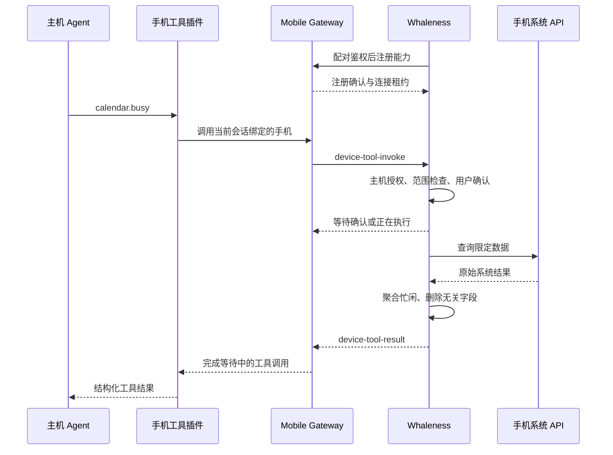

# Whaleness 手机系统工具与远端 Agent 接入方案

> 当前代码的交付范围、协议收敛和联调步骤见 [手机连接器实现与联调](phone-connectors-implementation.md)。本文保留整体设计和后续扩展目标。
> 交互已按当前需求调整：开启连接器即持续授权当前主机，不再逐次确认或预览。下文旧版逐次授权流程保留为历史设计，实际行为以实现说明为准。

日期：2026 年 11 月 9 日。状态：待实施技术设计。范围：Mobile Gateway、主机工具插件、KMP 共享层、iOS 与 Android App。

## 目标与范围

通过现有已配对连接，让 PC 或服务器上的 DSH 调用手机系统能力。Agent 调度、模型调用和会话持久化继续在主机；手机负责授权、数据查询、结果筛选和系统操作，不引入本地 DSH、Node 或 Linux 环境。

**明确排除联系人读取。** 不注册联系人工具，不请求通讯录权限，不接入 Contacts、Contacts Provider 或联系人选择器；日历结果也不返回参与人、邮箱和电话号码。后续阶段同样不包含通讯录。

首版采用只读能力：

| 工具 | iOS | Android | 首版输出 |
| --- | --- | --- | --- |
| `calendar.busy` | EventKit | Calendar Provider | 时间范围内的忙闲区间，不含日程标题、备注、地点和参与人 |
| `reminders.list` | EventKit 提醒事项 | 报告 unsupported | 选定提醒列表中、限定日期范围内的标题、截止时间、完成状态；不含备注和附件 |

只读是 Whaleness 的工具权限，不代表操作系统提供只读日历授权。Android 的事件提醒属于日历事件，不等同独立待办，不用它伪装系统提醒事项。

首版固定参数合同：

| 工具 | 参数 | 结果 |
| --- | --- | --- |
| `calendar.busy` | 必填 start、end、IANA timeZone；start < end，范围不超过 7 个日历天 | 合并后的 busyIntervals、timeZone、coverage、collectedAt；无标题等事件明细 |
| `reminders.list` | 必填 start、end、IANA timeZone；includeCompleted 默认 false，includeUndated 默认 false，limit 为 1–100 | items 包含 title、dueDate 或 null、completed；另有 coverage、collectedAt、truncated |

查询数据源由手机授权页面选择，不允许模型传入任意账户标识或系统数据库谓词。提醒查询按截止时间筛选，includeUndated=true 时才包含无截止日期项；结果按截止时间、完成状态和稳定内部顺序排序，结果不携带内部记录 ID。Reminder 到期只有日期时保留日期语义，不强制转为 UTC 午夜。

完整能力目录还纳入位置、照片和音乐模块，以及确认式日程/提醒写入和满足用途要求的健康汇总。各模块沿用同一设备调用链路，分批交付；18–30 人日仍仅指上表两项工具的基础首版。未交付模块不显示为已可用，也不提前申请相应权限。不提供通用脚本执行、任意系统 API 调用或完整数据同步。

## 扩展能力目录

以下覆盖连接应用界面中的本机能力，联系人继续排除。模块开启表示用户允许配置该能力，不等于具备全部系统权限、数据可用或主机已获得外发许可。

| 模块 | 建议工具 | iOS 接入 | Android 接入 | 能力边界 |
| --- | --- | --- | --- | --- |
| 日历 | `calendar.busy`，后续 `calendar.create` | EventKit | Calendar Provider | 先忙闲查询，写入需预览确认 |
| 提醒事项 | `reminders.list`，后续 create/complete | EventKit | 具体服务逐项适配，未实现时 unsupported | 不将日历事件提醒当成独立待办 |
| 健康 | `health.daily-summary` | HealthKit | Health Connect | 用途与外发条件确认后，按类型提供汇总 |
| 位置 | `location.current` | Core Location | 平台定位 API；可选可用的定位服务 | 前台单次查询，默认近似位置，不记录轨迹 |
| 照片 | `photos.select`，后续 search/export | PhotosPicker/PHPicker；后续 PhotoKit | 系统 Photo Picker/文档选择器；后续 MediaStore | 先用户选择，后续只在授权图库内按明确条件查询 |
| 音乐 | `music.search`、`music.state`，后续 play/pause/seek | MusicKit，明确选择 SystemMusicPlayer | 自有播放器或逐项接入的 MediaSession；Apple Music 需另做平台适配 | 不承诺控制任意音乐 App，不回传受保护音频 |

新增工具采用独立固定 schema 和 schemaVersion，只有 App、主机插件和 Gateway 均实现该工具后才注册；不能让注册快照扩展成任意系统方法调用器。不同模块复用 broker、租约、授权与取消合同，但保留各自的权限和数据策略。

### 单次位置

`location.current` 输入 requestedPrecision（coarse/precise）及 maxAgeSeconds；首批只开放 coarse，precise 作为需额外确认的扩展。输出为近似坐标、horizontalAccuracyMeters、sampledAt、precision 与缓存来源标志，不能只返回一个无时间和误差的经纬度。数据过旧或误差不满足约定时返回明确错误，不能称为当前位置。

iOS 使用独立的单次 CLLocationManager owner 和 `requestLocation()`，Android 使用有界单次定位；不改动后台保活管理器的定位参数。已有定位系统权限也不等于允许向远端发送位置，外发仍需本次确认。工具不申请 Always/后台定位权限，不开启轨迹采集，不将反向地理编码隐含地发给另一个服务。[Core Location 单次定位](https://developer.apple.com/documentation/corelocation/cllocationmanager/requestlocation())

系统可能只授权大致位置，App 不能自行提高精度。近似输出还需由端侧限制披露精度并报告实际误差；字段写 coarse 不能替代真实坐标处理。拒绝、超时和定位关闭分别报告状态，不从其他工具的缓存推断位置。

### 照片选择与查询

先实现 `photos.select`：Agent 发起请求后手机展示系统选择器，用户最多选择 3 张照片，预览要发送的内容，再同意外发。选择器可以只授予所选资源，无需为此索取整个相册权限；用户也可以在选择器内自行搜索。[Apple Photos Picker](https://developer.apple.com/videos/play/wwdc2023/10107/)

后续 `photos.search` 才申请有限图库访问，初始条件限定日期、媒体类型和用户选定相册，每次最多 20 个候选。它返回短期 assetHandle 与最少元数据，不返回系统原始资产 ID。assetHandle 绑定主机、会话、租约和授权版本，最长 30 分钟；切主机、撤权或租约结束立即失效。查询授权不等于上传许可。

“去年旅行时的海边照片”一类语义搜索不直接视为 PhotoKit 已开放的能力。首批让用户在系统选择器内搜索；后续若增加端侧视觉索引或模型筛选，需单独定义索引成本、候选图片外发和授权范围。不能读取 Apple Photos 的私有索引或默认将整库发给模型。[PhotoKit 授权范围](https://developer.apple.com/documentation/photokit/delivering-an-enhanced-privacy-experience-in-your-photos-app)

图片数据独立走有界媒体上传，设备工具控制结果只带 mediaRefs、格式、尺寸、字节数和采集时间。复用现有上传分块与回执实现，但增加 purpose=device-tool、invocationId 与租约绑定的暂存资源；不能直接复用会自动发送用户消息的附件提交路径。主机只允许对应调用读取回执，并通过原生工具图片结果送给支持图片的模型。

初始预算为每图压缩后不超过 4 MiB、最多 3 张，超限提示缩小或另选，不把二进制塞进 128 KiB JSON 结果。默认修正方向、缩放并重新编码，移除 EXIF/GPS；原图、拍摄位置和视频不在首批范围。iCloud 原图下载需纳入同一调用期限与取消，不能后台无限等待。取消或失败清理临时文件和未消费的主机上传回执，成功读取后的保留按已披露会话策略处理。

### 音乐查询与播放

iOS 的 MusicKit 可查询 Apple Music 内容并在授权后播放；播放能力还取决于账户订阅、地区和具体内容。优先选择 `SystemMusicPlayer` 控制系统 Music 播放状态，避免与 App 自建播放器混用。它不等于能读取全部现有队列或控制任意第三方音乐 App。[MusicKit](https://developer.apple.com/musickit/)、[SystemMusicPlayer](https://developer.apple.com/documentation/musickit/systemmusicplayer)

查询只返回曲目 ID、名称、作者和可播放状态；不向 Agent 返回开发者私钥、用户 token、音频字节或整段歌词。播放与 seek 属于有副作用的动作，需要显示目标曲目和操作范围，并沿用写操作的去重与未知结果处理。API 接受播放指令与观察到实际 playing 状态应分别表达，不在调度成功时直接声称用户已听到音乐。

Android 的 MediaController 只能使用目标应用暴露且允许的 session 命令。首批没有独立实现时报告 unsupported，不用任意包名、无障碍或通知访问权限替代播放器协议；也不能把 Android 上的通用播放器能力标成“Apple Music 已连接”。[Android 媒体控制](https://developer.android.com/media/media3/session/connect-to-media-app)

实际音频播放需与现有静音保活的 AVAudioSession 协调，使用共同 owner 或优先级策略，真实播放和录音优先；停止工具调用只停止它拥有的播放动作，不抢占或销毁其他播放会话。真实音乐播放可以继续由系统播放器管理，但不代表手机工具 broker 获得无限后台执行时间。

### 连接应用界面

“手机能力”页面改为可扩展模块目录，展示已启用、待授权、不可用、未实现及断线状态；日历、提醒、位置、照片、音乐、健康分别有详情页和主机授权范围。截图中的数量应由实际注册目录计算，不硬编码 7/36/27，也不因为截图显示已授权就假定本 App 已获系统授权。

本机模块通常使用系统权限或选择器；云端模块使用相应服务 API/OAuth；其他设备模块使用设备配对与远端能力注册。三种连接机制在产品上可统一目录，但不能把“连接”按钮做成通用 OAuth 或请求所有系统权限。先落地本机目录，云端和其他设备目录不在本轮实施估算内。

成功示例：用户在手机询问“明天什么时候能安排两小时学习”，Agent 获取授权的忙闲区间并回答；用户离开 App 后，主机仍可继续完成不依赖手机的新步骤。

## 现有基础和必须新增的部分

| 层次 | 现有基础 | 新增工作 |
| --- | --- | --- |
| 网关连接 | `MobileConnection` 封装 WebSocket/RTC，保存 deviceId、generation 和 channel | 能力租约、设备路由、反向请求关联、超时和撤销 |
| 网关鉴权 | 配对设备凭据、撤销、可信设备目录 | 手机工具强制要求设备鉴权，独立于普通调试开关 |
| 通道 | 控制和会话分离；旧客户端有 legacy 单连接 | 手机工具仅走 control 或 legacy，不占用历史/流式会话通道 |
| 主机 Agent | Gateway 当前适配 DSH Host Remote API | 新增真正注册到 Agent 的手机工具插件与设备服务 |
| KMP | 协议、请求状态和平台接口 | 专用设备工具 DTO、状态机、授权策略与执行合同 |
| iOS | Swift GatewayClient 与 KMP 状态适配 | 专用设备工具入口、EventKit、授权与确认界面 |
| Android | 共享 GatewayRuntime 与平台 transport | 专用设备工具入口、Calendar Provider、授权界面 |

`lib/gateway-tools.mjs` 当前负责桌面 Web 重启辅助逻辑，并非 Agent 工具注册器。`NodeForwarding.swift` 是隧道端点映射，也不承担手机系统工具调用。实施时不把这两个同名概念当成已有能力。

## 总体数据链路



连接由 App 主动建立，主机通过已有连接反向发帧；不在手机启动 HTTP 服务，不开放端口，不要求公网可达地址。控制帧使用现有传输队列，平台查询和用户交互不得阻塞 socket 读循环。

模型只看到固定工具描述，主机插件才执行请求。返回结果由正常 tool/result 路径进入 Agent 上下文，不生成新的用户消息，不直接拼接为系统指令。日程和提醒标题始终作为不可信数据处理。

## 身份与多设备路由

调用的可信归属由网关根据运行中的 Agent 上下文确定：gatewayId、sessionId、toolCallId、调用主体和被绑定的 deviceId。模型不得自行伪造会话身份、跨会话选择目标手机，也不能通过更改工具参数取得其他主机的手机授权。

App 的主机授权键建议使用 `(gatewayLocalId, verifiedGatewayId, credentialEpoch)`。verifiedGatewayId 必须来自已配对的可信连接；服务器声明的 gatewayId 字符串自身不是身份认证。端口变化不改变主机归属，重新配对或凭据主体变化需要重新授权。

首版设备选择规则：

1. 在 App 会话设置中开启“允许此会话使用本机工具”，建立明确设备绑定。
2. 从 PC 发起的会话需先由用户选择手机并在手机确认绑定；没有绑定时返回 `device_not_bound`，不自动选择在线设备。
3. 多台同名手机通过稳定设备 ID 区分；显示名仅用于 UI。
4. 不广播查询，不同时调用所有在线手机；子 Agent 默认不继承授权，需要独立授权范围。

同一主机、同一设备只接受一个有效工具控制连接。新连接成功注册时撤销旧工具租约，取消旧连接未完成调用。连接选择可按最新完成注册的 control/legacy 确定，但旧连接不得仅凭迟到注册抢回租约：网关只允许当前最高有效连接代次注册。

`generation` 是网关进程内代次，不是跨重启身份。每次注册生成随机 `connectionLeaseId`，所有下发和回包必须绑定它；网关重启或承载重建导致租约变化。逻辑连接在承载切换时若仍保持原 owner 和顺序，可保留租约；重新创建逻辑连接必须重新注册。

## 协议设计

保持 Gateway protocol 3，新增可选 capability `device-tools-v1`。只有功能已开启且当前设备已鉴权的连接才能在 hello 中收到该 capability；未配对的调试连接不能注册或执行手机工具。

App 看到 capability 后才发送注册。新 App 连旧网关隐藏入口；新网关连旧 App 不发主动工具调用。工具 schema 固定在 App 与主机插件，不接受手机上传可执行代码或任意 JSON Schema。注册采用完整快照，schemaVersion 不兼容时拒绝。

| 方向 | 消息 | 用途 |
| --- | --- | --- |
| App → Gateway | `type=device-tools-register` | 注册或替换当前连接的工具状态快照 |
| Gateway → App | `kind=device-tools-registered` | 返回租约与能力版本 |
| Gateway → App | `kind=device-tool-invoke` | 下发一次调用 |
| App → Gateway | `type=device-tool-state` | 报告 awaiting-user、running 或 cancelling，不结束工具调用 |
| App → Gateway | `type=device-tool-result` | 单次终态结果，成功或明确错误 |
| Gateway → App | `kind=device-tool-cancel` | 取消指定调用 |
| App → Gateway | `type=device-tool-cancelled` | 仅在执行已停止时确认取消；未停止则发 cancelling 状态 |

设备注册使用 requestId 与递增的 capabilityRevision。注册确认前不得执行反向请求；后续权限或主机授权变化须替换能力快照。同一租约不接受回退 revision，重新注册不得复活旧调用。

### 注册示例

```json
{
  "type": "device-tools-register",
  "requestId": "reg-001",
  "version": 1,
  "capabilityRevision": 1,
  "tools": [
    {"name": "calendar.busy", "schemaVersion": 1, "state": "requires-user-action"},
    {"name": "reminders.list", "schemaVersion": 1, "state": "unsupported"}
  ]
}
```

state 枚举为 `disabled`、`requires-user-action`、`ready`、`unsupported`；这是可用性提示，不是执行许可。不得把健康数据的“读不到”反推成确定的系统权限状态。设备身份取鉴权连接，不接收注册载荷指定另一个 deviceId。

```json
{
  "kind": "device-tools-registered",
  "requestId": "reg-001",
  "version": 1,
  "connectionLeaseId": "lease-random",
  "capabilityRevision": 1
}
```

### 查询与结果示例

```json
{
  "kind": "device-tool-invoke",
  "version": 1,
  "invocationId": "inv-random",
  "connectionLeaseId": "lease-random",
  "sessionId": "session-456",
  "toolCallId": "call-789",
  "capabilityRevision": 1,
  "tool": "calendar.busy",
  "schemaVersion": 1,
  "arguments": {
    "start": "2026-11-10T00:00:00+08:00",
    "end": "2026-11-11T00:00:00+08:00",
    "timeZone": "Asia/Shanghai"
  },
  "timeoutMs": 120000,
  "consentContext": {
    "providerId": "configured-provider",
    "modelId": "configured-model",
    "purpose": "安排明天的学习时间",
    "sessionPersistence": true
  }
}
```

invocationId 是本次工具调用的随机唯一标识，独立于正向 RPC 的 requestId。Gateway 内 pending 表保存完整可信身份，App 回包无需重新声明或选择 sessionId、toolCallId。consentContext 的 Provider 和模型由主机插件读取实际会话配置，purpose 仅作展示，不能扩大工具权限。该上下文不是对主机未来数据用途的密码学证明。

```json
{
  "type": "device-tool-result",
  "version": 1,
  "invocationId": "inv-random",
  "connectionLeaseId": "lease-random",
  "status": "success",
  "result": {
    "timeZone": "Asia/Shanghai",
    "coverage": "selected-calendars",
    "busyIntervals": [
      {"start": "2026-11-10T09:00:00+08:00", "end": "2026-11-10T10:00:00+08:00"}
    ],
    "collectedAt": "2026-11-09T20:00:00+08:00",
    "truncated": false
  }
}
```

coverage 表明结果只涵盖用户开放的日历。空数组仅表示“在该查询范围与授权来源内未发现忙碌”，不表示所有账户或所有设备都没有日程。超过结果上限时返回 `result_too_large` 要求缩小范围，不能把截断数据当成完整忙闲结果。

失败使用 `status=error` 和结构化 error：`{code, retryable}`，不返回系统原始异常、内部路径或私有数据。state、cancel 和 cancelled 同样携带 version、invocationId 和 connectionLeaseId。

### 状态与期限

```text
主机：created → dispatched → awaiting-user / running → succeeded / failed / cancelled / timed-out
手机：received → validating → awaiting-user → executing → succeeded / failed / cancelled
```

已有有效的用户授权时可以跳过 awaiting-user。取消时进入 cancelling，平台确认停止或查询最终回调被丢弃后再进入 cancelled；主机的等待可以先行超时结束，不能据此假定手机原生查询线程已退出。

Gateway 从创建调用时启动单调时钟全程期限，App 从收到请求起也有本地上限；状态消息不延长期限。日期时间使用带时区的 ISO 8601，调用超时不依赖两台机器的墙钟完全一致。

首版建议默认：全程 120 秒，原生查询 15 秒，单设备最多 2 个查询、全 App 同时 1 个授权 UI；没有授权 UI 槽位时返回 busy。参数 JSON 上限 16 KiB，结果上限 128 KiB，日历范围最多 7 天，提醒事项最多 100 条。以上为初始限额，实施时按真实设备测量调整；Reminder 结果带 truncated，忙闲结果不能静默截断。

终态只结算一次。查询回调、超时、取消、断线同时发生时，由同一状态机串行准入。状态等待和执行均不占用连接接收锁。

## 网关侧修改

### 连接入口和设备服务

在 Gateway 增加默认关闭的 `deviceToolsEnabled` 配置。`lib/index.mjs` 保持连接组装，在 `activateBusinessConnection` 中接入独立模块，不继续把状态机展开到主文件。

建议新增 `lib/device-tools/`：

| 文件 | 职责 |
| --- | --- |
| `protocol.mjs` | 消息校验、固定工具 schema、版本与大小限制 |
| `registry.mjs` | 鉴权设备、连接 owner、租约和能力快照 |
| `broker.mjs` | invoke/cancel、pending 表、期限、单次结算 |
| `service.mjs` | 向同 Host 的工具插件公开受控服务 |
| `policy.mjs` | 功能配置、会话设备绑定、允许工具和安全传输策略 |

服务合同建议为 `listDevices(context)`、`invoke(context, tool, args, signal)` 和 `cancel(invocationId)`，是设计接口名，不冒称已有 SDK API。context 来自经过验证的 DSH 会话执行上下文，不由模型提供。设备目录按调用主体与授权过滤，不向其他主体暴露手机名称或能力。

处理 App 消息时先完成 channel 与已配对设备检查，再交给设备工具模块。只有符合 `pending.owner === currentConnection`、deviceId、leaseId、invocationId 的结果才可结算；不能只按 invocationId 匹配。设备撤销、Gateway 禁用或插件销毁时撤销租约、拒绝新调用、取消全部 pending 并释放计时器。

每个终态清理 pending；迟到结果只记录匿名错误码和次数，不进入 Session。日志只记录工具名、调用标识、阶段、耗时和字节数，不记录参数、结果、purpose、日历和提醒标题。不得复用会输出完整帧的诊断路径。

### 主机工具插件

建议新增独立包 `dsh-plugin-whaleness-phone`，依赖 Gateway 新发布的设备服务；Gateway 的普通远程聊天仍可单独运行。工具插件必须在运行 Agent 的服务平面完成注册，并允许当前 Agent preset 使用它。现有 Gateway bundle 位于 Host 平面，不能只增加 WebSocket 消息就认为模型已经有工具。

固定注册 `phone_calendar_busy`、`phone_reminders_list` 两个类型明确的工具。具体 DSH 注册 API、执行上下文和取消信号，以实施时锁定版本的 SDK 为准；P0 必须用真实 DSH 跑通注册和一次假设备调用，验证 Host 与 Agent 服务平面的连接方式。若直接服务注入不可跨平面，则实现经过鉴权、携带可信执行上下文的 Host Remote 方法；不增加可被匿名调用的本地 HTTP 后门。

工具调用顺序：校验当前会话绑定及主体 → 校验参数 → 创建一次 broker 调用 → 等待终态 → 将 result 作为标准工具结果返回。DSH 的工具取消信号传播至 broker，再发送设备取消；不模拟取消成功，不向用户会话插入第二条 prompt。用户可见错误本地化，协议错误码保持稳定。

工具目录可保留固定 schema，但实际执行时重新检查能力和绑定。手机上线或离线不应不断全局重写其他会话的工具集合。插件不得通过业务默认权限中的 `danger-full-access` 绕过手机端授权。

## KMP 共享层修改

建议在 `shared/.../devicetools/` 新增以下组件：

- `DeviceToolProtocol`：注册、调用、状态、结果和错误 DTO；schema 与网关 fixture 对齐。
- `DeviceToolCoordinator`：准入、并发、期限、取消、终态与平台执行调度。
- `DeviceToolPolicy`：每主机、每会话的能力开关、查询范围和授权版本。
- `DeviceToolStore`：UI 所需待确认操作和审计元数据，不存原始查询结果。
- `DeviceToolPlatform`：可用性查询、系统授权、执行和尽力取消接口，由平台实现。

平台合同概念为 `capabilities()`、`execute(invocation, grant)`、`cancel(invocationId)`。授权弹窗是 UI effect，不在共享层或 socket 线程直接弹窗。一次本地 grant 绑定主机、租约、调用、工具、规范化参数摘要、授权版本和有效期；执行前和出站前都重新核验。

Android 的 `GatewayRuntime` 对 device-tool 帧建立专用入口，在普通 `correlateLocked` 和正向 RPC lane 处理前分流。新增结构化事件或注入 coordinator，不把设备调用当成某条 history/models 请求的应答。回包需有受控的控制通道发送接口，不能绕过当前 generation 校验直接持有旧 socket。

iOS 当前由 Swift `GatewayClient` 管理网络，保持此结构，在控制帧收到后交给共享 coordinator；通过 Swift facade 把状态转成 UI effect，并将结果编码后交回当前连接。无需先迁移完整 KMP GatewayRuntime。

设备请求只在共享 coordinator 中产生一个执行副作用。AppStore/AndroidSharedStateHolder 订阅的是 UI 镜像，不能各自再执行一次。新帧不会进入 Conversation/Trajectory reducer，敏感回包不经过普通聊天缓存或错误帧打印。

## iOS App 修改

建议新增 `Core/DeviceTools/`，包含 EventKit 适配、平台 facade 和本地授权存储，并在项目文件注册源码。Swift AppStore 负责转发 UI effect；平台执行器使用异步 API，查询结果排序聚合在后台处理，授权与确认在 MainActor。

日历选择、提醒列表选择属于授权 UI，相关列表名只在本机显示。`calendar.busy` 查询用户选定日历，按真实时区展开指定区间的重复日程，处理全天日程与 free/busy 标记，合并重叠区间；无法确定忙闲的事件采用保守规则并在工具说明固定。使用夏令时地区的日历天边界，不假设一天永远 86400 秒。

系统权限配置：

- iOS 16.1 至 16.x：`NSCalendarsUsageDescription`、`NSRemindersUsageDescription` 与对应旧版请求 API。
- iOS 17 及以上：`NSCalendarsFullAccessUsageDescription`、`NSRemindersFullAccessUsageDescription`，使用 full access 请求 API。
- 首版不注册写工具；即使系统授权包含写权限，工具执行器仍拒绝写操作。没有通讯录用途字符串。

授权未确定时只在前台由明确用户操作请求。后台收到需要授权的调用立即返回 `user_action_required`，不尝试展示系统弹窗。锁屏、受保护数据不可用、权限被撤销分别报告明确状态。[Apple EventKit 权限说明](https://developer.apple.com/documentation/eventkit/accessing-the-event-store)

现有 `AgentBackgroundExecutionController`、定位、音频和 iOS 26 持续任务只提供执行机会。收到远端设备调用不伪造本地用户回合、不自动申请新的长期保活。App 被挂起时不能承诺查询会执行，回前台后到期请求不得补执行。

## Android App 修改

建议新增 `platform/devicetools/`，Calendar Provider 适配通过 ContentResolver 查询，接入 `AndroidAppGraph` 的主机范围 coordinator；系统权限弹窗由 Activity/UI 执行，不能从 Application 或后台 service 直接展示。

读取日历按需声明并请求 `READ_CALENDAR`，首版不声明 `WRITE_CALENDAR`、READ_CONTACTS 或 WRITE_CONTACTS。共享工具 schema 保持一致；reminders.list 返回 unsupported，不能抓取其他待办 App 私有数据库。[Android 日历 Provider](https://developer.android.com/identity/providers/calendar-provider)

AndroidAppGraph 切换或销毁时撤销该主机的 pending UI 和执行 owner；Application 级只负责 UI 串行协调与当前前台窗口，不持有跨主机可复用授权。明确采用“首版仅前台活动主机接收新设备调用”的规则：切主机取消旧主机待确认/执行中调用，旧结果不能回到新主机。iOS 同样遵守，其他主机可以继续其远端 Agent，但手机工具在其非活动状态下不可用。

后台已有 Agent 前台服务不能当成日历授权。不开启为手机工具常驻的独立服务，机型、系统版本、无日历账户等情况动态报告，不增加现有 minSdk。

## App 授权与用户流程

设置新增“手机能力”入口，按主机展示实际已交付的模块；初始为日历忙闲和 iOS 提醒事项，扩展批次逐项加入位置、照片、音乐和健康。默认关闭，首次启用依次完成对应系统授权、来源选择、外发用途说明；App 页面和菜单沿用现有设计，Android 使用 DshMenu/DshMenuHost。

授权须区分三层：系统允许 App 读取；用户允许某主机/会话调用；用户允许把指定结果发往该主机及模型。首版只支持“本次调用”；当前会话内复用授权作为后续易用性扩展，需另定有效期和撤销合同，不提供永久全量导出授权。

确认页显示主机和目标设备、会话、工具、具体时间范围、输出字段、模型提供方，以及结果会进入主机会话的事实。忙闲查询只发送忙闲时间；提醒查询在本机先预览将发送的标题。用户可以拒绝或缩小范围，范围变化形成新参数摘要并重新确认。

用户撤销、切主机、重配对、模型提供方变化、App 退后台或连接租约变化时，使待确认 grant 失效；模型变化由主机在调用前读取实际会话配置，并在变化时取消原调用。手机无法验证恶意主机是否诚实披露后续模型用途，因此配对主机本身仍是信任边界。

回包成功前再检查授权是否仍有效。撤销以后不得因查询已结束就继续发数据。回前台恢复的是未过期 UI 状态的重新准入，不自动复用旧确认。

## 传输与数据留存

首版设备工具只允许在经过验证的加密链路运行：WSS、已验证的 RTC 安全承载，或 App 确认使用可信加密隧道的路由。仅以局域网地址或 `ws://` 字符串不能判断安全；明文且无可信隧道时隐藏能力并返回 `secure_transport_required`，不改变现有聊天连接政策。

若 WSS 在代理服务终止 TLS，该代理属于能接触数据的链路主体；不能把它宣传为端到端加密。额外的应用层加密需要独立设计密钥协商，不属于首版。

App 不建立查询结果磁盘缓存，临时结果仅供当前调用和同租约的短时去重，完成后限时清除。审计只保存工具、时间、主机、范围类别和状态，不保存提醒标题或日程正文。网关 broker 也不保存结果文件。

扩展照片模块是上述无磁盘结果缓存规则的显式例外：只允许有期限的媒体暂存和上传回执，按图片模块的清理合同处理；不得形成持久相册镜像。位置、健康和曲库结果继续默认不建立本机磁盘缓存。

标准工具结果可能被 DSH 写入会话，并随模型请求外发；“不写 broker 日志”不能承诺“主机不留数据”。授权 UI 必须披露，主机工具结果大小与字段也需严格限制。已发送的数据无法通过手机撤权追溯删除，撤权只阻止未来调用。[Apple 数据使用与第三方 AI 规则](https://developer.apple.com/app-store/review/guidelines/#privacy)

## 异常与恢复合同

| 错误码 | 语义 | 默认处理 |
| --- | --- | --- |
| `device_not_bound` / `device_offline` | 未选择设备或没有有效租约 | 不发请求，提示用户选择或打开手机 |
| `tool_disabled` / `tool_unsupported` | 主机开关关闭或平台无能力 | 返回明确工具错误，不降级为其他工具 |
| `permission_denied` / `user_action_required` | 确定拒绝，或需要前台操作 | 用户进入 App 后以新调用重新准入 |
| `device_locked` / `data_unavailable` | 当前无法获取数据 | 不返回空成功，不推断没有记录 |
| `scope_rejected` / `result_too_large` | 范围过宽或结果超限 | 缩小范围后发起新调用 |
| `busy` | 查询或授权 UI 槽位用尽 | 有界重试并仍受全程期限约束 |
| `invocation_timeout` / `device_disconnected` | 超时或 owner 断开 | 终止主机等待，不在重连后补执行 |
| `cancelled` | 已取消且不再产生外发结果 | 终止工具等待 |
| `stale_lease` / `invalid_request` | 旧连接、重复冲突或协议错误 | 拒绝，不进入平台 API |

同一租约、同一 invocationId、相同参数的重复帧只复用已有状态或短时终态；同 ID 不同参数拒绝。主机超时后发送 cancel 并结算工具超时，App 禁止迟到结果外发；不能中止的原生查询保留独立执行 owner 和并发槽直到回调完成，不用超时释放槽位制造无限后台查询。

取消未确认用 `device-tool-state` 的 cancelling 阶段表达，不发送 `device-tool-cancelled`，也不把非终态伪装成普通 error 结束本地 owner。

读取调用在断线后不自动重放；模型如需再次读取，创建新调用并重新校验授权。网关重启使 pending 失败，App 进程被杀则本次调用无法恢复；两侧都不持久化首版读请求以便自动执行。

## 后续写操作与健康能力

写操作不能仅复制读取协议。新增 operationId、参数摘要和持久执行日志，先落执行意图再调用系统 API。处理“已经写入、尚未记录结果就崩溃”的窗口时，进入 outcome_unknown 并查询实际对象，不自动重试创建。API 无法支持可靠幂等时不承诺 exactly-once。修改和删除还需对象 revision/内容指纹，防止覆盖用户在其他 App 的改动。

健康阶段先确认产品具备真实健康或健身功能，以及主机和模型的数据使用条件。授权单独按数据类型和日期范围管理，端上统计后只发送必要汇总；不包含临床病历、原始连续采样和健康写入。HealthKit 空结果不能等同已拒绝或值为零，锁屏还可能影响读取。普通 Agent 工具插件不能天然获得健康数据外发资格。[HealthKit 隐私要求](https://developer.apple.com/documentation/healthkit/protecting-user-privacy)

Android 健康能力按 Health Connect 的运行时可用性检查，不提高主 App minSdk，也不承诺所有厂商健康数据都存在；未支持的设备保持 unsupported。[Health Connect 可用性](https://developer.android.com/health-and-fitness/health-connect/availability)

## 具体改动清单

| 仓库 | 现有位置 | 实施改动 |
| --- | --- | --- |
| Gateway | `lib/index.mjs`、`lib/mobile-connection.mjs` | 接入 broker，绑定逻辑连接 owner；必要时扩展 transport 安全元数据 |
| Gateway | `cordis.patch.yml`、`package.json`、`PROTOCOL.md` | 功能配置、服务发布、能力协商与协议文档；工具插件独立安装 |
| Gateway | `test/` | 协议、假设备、真实 DSH 工具注册、撤销和重连测试 |
| Mobile | `shared/.../protocol/GatewayDtos.kt`、`GatewayWireDecoder.kt` | 新增嵌套设备工具 DTO 和严格校验，不放宽旧字段 |
| Mobile | `shared/.../gateway/GatewayRuntime.kt`、平台合同 | 控制帧分流、当前代次回包和连接关闭通知 |
| Mobile | `shared/.../devicetools/`、`facade/` | 共享 coordinator、policy、store 和 Swift facade |
| iOS | `Core/GatewayClient.swift`、`GatewayFrameRouter.swift`、`GatewayModels.swift`、`AppStore.swift` | 专用控制入口与 UI effects，避免普通聊天状态接收敏感数据 |
| iOS | `Core/DeviceTools/`、Views、Info.plist、Localizable.xcstrings、project.pbxproj | EventKit、授权页面、用途文案和源文件注册 |
| Android | `AndroidAppGraph.kt`、`AndroidSharedStateHolder.kt`、`AndroidMultiGatewayStore.kt` | 主机作用域 owner、切主机撤销和前台 UI 接入 |
| Android | `platform/devicetools/`、UI、Manifest | 日历实现、按需权限与双语文案 |

所有文件名为建议落点，落地时沿用仓库实际结构。仅修改方案文档不代表上述模块已经存在。

## 实施阶段与验收

以下为熟悉 DSH、KMP 和两端平台的一名工程师的初步人日估算，不含健康、写操作和商店审核等待。

| 阶段 | 产物 | 必须通过的验收 | 估算 |
| --- | --- | --- | --- |
| P0 宿主和协议验证 | 固定 DSH/Gateway 版本、JSON fixtures、假设备与真实工具插件 | 模型工具调用能走到假手机并返回标准 tool/result；取消信号贯穿两侧 | 3–5 人日 |
| P1 网关和共享层 | broker、租约、状态机、平台 fake | 双设备不串结果；旧租约、错通道、未配对和超限帧被拒绝；历史协议无回归 | 4–7 人日 |
| P2 iOS 日历闭环 | 手机授权、选日历、忙闲查询、真实回答 | 用户授权后 Agent 基于手机忙闲回答；拒绝/锁屏/退后台行为明确 | 4–6 人日 |
| P3 Android 与提醒扩展 | Android 日历、iOS 提醒事项、UI 对齐 | 两端同日历 fixture 语义一致；Android 提醒工具明确 unsupported | 4–7 人日 |
| P4 真机和发布 | 故障、隐私、后台与兼容验证 | 完成以下矩阵，无敏感内容进入日志或错误输出 | 3–5 人日 |

首版约 18–30 人日，P0 完成后依据实际 DSH 插件合同与服务平面成本重估。

扩展目录另分批实施，不包含在上述首版估算内：

| 批次 | 范围 | 放行条件 |
| --- | --- | --- |
| E1 位置与选图 | 前台单次近似位置、用户选定照片及媒体传输 | 位置时效/精度和撤权正确；无 EXIF/GPS 意外外发；无大图内存失控 |
| E2 日程与提醒写入 | 预览后创建，后续再考虑修改和完成 | 持久化去重、结果未知和用户修改冲突测试通过 |
| E3 音乐 | iOS MusicKit 查询与播放；Android 单独判定实现范围 | 账户/订阅/地区检查、音频会话共存、播放状态与取消测试通过 |
| E4 照片检索 | 授权图库内的元数据筛选和短期资产引用 | 有限授权、撤权、iCloud 下载、资产句柄失效与上传许可分别验证 |
| E5 健康汇总 | 明确健康用途后按数据类型读取汇总 | HealthKit/Health Connect 可用性、用途和数据分享条件通过；无数据不生成零值 |

E1 至 E5 分别完成最小原型后估算工期，不用日历首版人日直接覆盖全部目录。健康条件不满足时保留 disabled/unsupported，不阻塞其他模块交付。

验收矩阵：

1. **协议**：版本、坏 JSON、未知工具、未知字段、巨大结果、重复 ID 和相同 ID 不同参数。
2. **身份**：两台手机、两个主机、两个会话、两个连接代次；伪造 deviceId、错租约和撤销设备后回包全部不能结算其他调用。
3. **授权**：关闭能力、系统拒绝、查询期间撤权、确认期间切主机/模型/后台，均不得外发旧结果。
4. **恢复**：发出前、执行中、查询后回包前三个时点断线或杀 App；超时和结果同时到达只产生一个终态。
5. **数据语义**：全天、重复、跨午夜和夏令时日历；部分日历授权、空范围、超限；Reminder 日期缺失不得当作已完成或今天到期。
6. **生命周期**：只在前台活动主机执行；不因手机工具调用创建用户回合、长期后台任务或永久服务。
7. **隐私**：fixture 注入敏感字符串，检查 App/网关日志、诊断导出、崩溃上下文和普通聊天缓存均无泄露；主机会话中出现的工具结果符合授权字段。
8. **兼容**：旧 App/新 Gateway、新 App/旧 Gateway、legacy/control、WebSocket/RTC 与可信隧道路由。
9. **扩展模块**：位置旧样本与近似精度；照片有限授权、元数据清理、超大图和 iCloud 下载；音乐无订阅、播放器被抢占与静音保活冲突；健康锁屏和缺失数据。

KMP commonTest 覆盖共享状态与授权竞争；Gateway node:test 覆盖 broker 和连接 owner；iOS XCTest 和 Android 单元/仪器测试覆盖 native adapter 与权限 UI。采用确定性假模型和固定设备数据验证完整链路，再用真实 Provider、签名真机进行手工验收。

P0 完成标准是“真实 DSH 的一次工具调用能通过 Gateway 向假设备取数据并正常结束”，而非只有 socket 发帧成功。达到这一点后，再开始平台权限与 UI 的完整实现。
