<div align="center">

[English](../../README.md) · [简体中文](../../README.zh-CN.md) · [日本語](README.ja.md) · [한국어](README.ko.md) · [Español](README.es.md) · **Français** · [Deutsch](README.de.md) · [Português (Brasil)](README.pt-BR.md)


# Whaleness — Client mobile tiers pour DeepSeek Harness

**Des applications natives Android et iOS dont la logique principale est partagée avec Kotlin Multiplatform.**

Connectez-vous à DeepSeek Harness via Mobile Gateway pour accéder aux espaces de travail, conversations en direct, traces de l’Agent, plugins, tâches planifiées et fichiers depuis votre téléphone, tablette ou appareil pliable.

Site web : [Whaleness](https://clarklevis1995.github.io/dsh-mobile/)

<p>
  <a href="https://testflight.apple.com/join/1Euwby6r"></a>
  &nbsp;&nbsp;
  <a href="https://github.com/Clarklevis1995/dsh-mobile/releases"></a>
</p>


</div>

## Présentation

Whaleness est un client mobile natif tiers pour DeepSeek Harness, développé de manière indépendante. Les applications Android et iOS utilisent Kotlin Multiplatform (KMP) :

- `shared` est la source de vérité de l’état métier partagé : protocoles, machines à états, réducteurs, projections et synchronisation.
- `androidApp` implémente l’application Android avec Kotlin, Jetpack Compose et OkHttp.
- `DeepSeekHarnessMobile` construit l’interface iOS avec SwiftUI/UIKit et accède à la logique partagée via un framework Kotlin/Native.

Les deux applications se connectent à Harness par WebSocket via [`dsh-plugin-mobile-gateway`](https://github.com/Clarklevis1995/dsh-plugin-mobile-gateway). Le réseau, le stockage sécurisé, les fichiers, les images, le cycle de vie et l’exécution en arrière-plan utilisent les API natives de chaque plateforme. Les règles métier sont regroupées dans `shared/commonMain` lorsque cela est pertinent.

## Téléchargement et prérequis

- **iOS** : [Rejoindre la bêta TestFlight](https://testflight.apple.com/join/1Euwby6r). Compatible avec les iPhone et iPad sous iOS / iPadOS 16.1 ou version ultérieure.
- **Android** : [Télécharger un APK depuis GitHub Releases](https://github.com/Clarklevis1995/dsh-mobile/releases). Android 7.0 (API 24) ou version ultérieure est requis. La recherche de mises à jour privilégie la source de téléchargement accélérée et vérifie les paquets téléchargés.
- **Hôte de bureau** : lancez DeepSeek Harness avec **`dsh-plugin-mobile-gateway` 0.11.1 ou version ultérieure** installé et activé. [`AppRelease/release-info.json`](../../AppRelease/release-info.json) définit la version minimale requise.
- **Saisie vocale** : activez le plugin officiel de saisie vocale dans la section des plugins de l’hôte, terminez le téléchargement et l’initialisation du modèle, puis autorisez l’accès au microphone sur l’appareil mobile.

## Communauté bêta

Rejoignez le groupe WeChat nº 2 de la bêta Whaleness pour partager votre expérience, signaler des problèmes et obtenir de l’aide. Scannez avec WeChat ou enregistrez l’image pour la reconnaître dans WeChat.

<p align="center">
  <a href="../../website/assets/support-wechat-2026-10-28.png"></a>
</p>

> Mis à jour le 28 octobre 2026. L’image d’origine indique que le code est valable avant le 4 novembre 2026. S’il a expiré, consultez la [page du produit](https://clarklevis1995.github.io/dsh-mobile/) pour obtenir le dernier code QR.

## État des plateformes

| Plateforme / module | État | Principaux composants |
| --- | --- | --- |
| KMP `shared` | Utilisé par Android et iOS | Protocole Gateway, stores/réducteurs, projections des conversations et traces, synchronisation de l’historique, questions/approbations, contrôle des sessions, état des fichiers et aperçu du code |
| Android | Client natif disponible | Jetpack Compose, OkHttp WebSocket, DataStore pour les réglages non sensibles, Keystore pour les identifiants, lecture QR CameraX/ML Kit, service au premier plan, cache des pièces jointes, téléchargements et aperçus |
| iOS | Client natif disponible | SwiftUI/UIKit, URLSession WebSocket, UserDefaults pour les réglages non sensibles, Keychain pour les identifiants, appairage QR, exécution en arrière-plan, pièces jointes et fichiers de l’espace de travail |

> Android et iOS disposent chacun d’une interface native et d’intégrations propres à leur plateforme. Les fonctionnalités et interactions sont progressivement harmonisées ; certains comportements système restent différents.

## Fonctionnalités

### Nouveautés récentes

- **Équipes d’Agents** : consultez les membres, alternez entre les conversations du responsable et des membres, et suivez les tâches partagées avec leur état, attribution et lien vers la conversation associée.
- **Envoi de fichiers** : choisissez des fichiers dans la conversation, suivez l’envoi, retirez les pièces jointes ou réessayez après un échec. Les fichiers envoyés et générés apparaissent sous forme de cartes à ouvrir ou télécharger.
- **Sélection de texte et tableaux** : sélectionnez, sélectionnez tout et copiez dans un écran dédié sans perdre votre position dans la conversation. Affichez les tableaux Markdown en plein écran, faites-les pivoter, copiez-les ou exportez-les en CSV ; les petits tableaux s’adaptent à la largeur, les grands défilent horizontalement.
- **Historique et stockage** : mettez les conversations en cache local et recherchez les conversations courantes hors ligne. Consultez l’espace occupé par les images, l’historique, les aperçus et les fichiers temporaires, puis videz le cache local par catégorie. L’historique est restauré au retour dans une session et les anciens messages sont chargés progressivement.
- **iPhone Duo et écrans larges** : colonnes d’accueil, zones de sécurité, saisie et fond animé s’adaptent au pliage, dépliage et à la rotation. Les conversations larges disposent d’une barre latérale permanente regroupant les sessions par espace de travail ; navigation et commandes des tâches s’adaptent à l’espace disponible.
- **Compatibilité iOS 16.1** : la version minimale est désormais iOS 16.1, avec des interfaces adaptées aux anciens systèmes. Les effets et fonctions système dépendent de la version d’iOS et des capacités de l’appareil.
- **Interactions natives améliorées** : menus en verre dépoli, renommage de sessions et navigation par balayage sur Android ; reconnexion au retour d’arrière-plan, exploration des fichiers et compatibilité des images sur iOS.

### Conversations et exécution de l’Agent

- **Conversations natives en direct** : traitement des événements incrémentaux WebSocket avec Markdown, code, raisonnement, appels d’outils, résultats et images jointes.
- **Saisie vocale et textuelle** : maintenez la zone dédiée enfoncée pour parler ; relâchez pour transcrire dans un brouillon modifiable, ou glissez vers le haut pour annuler. La transcription utilise la saisie vocale de l’hôte.
- **Historique, files d’attente et commandes** : fusion de l’historique paginé avec les événements récents en direct et suppression des doublons. Consultez et modifiez les messages en attente et utilisez les commandes slash de l’hôte. Sur iOS, le chargement de messages anciens conserve la position de lecture.
- **Traces de l’Agent** : consultez les événements User, Assistant et Tool, leurs arguments, résultats, schémas, consommation de tokens et durées.
- **Flux interactifs de l’Agent** : répondez aux Human Questions et demandes d’approbation d’outils : envoi, annulation, refus ou autorisation unique.

### Hôtes, espaces de travail et extensions

- **Plusieurs hôtes et sessions** : enregistrez et sélectionnez des hôtes Gateway avec des identifiants distincts. Parcourez, créez et changez d’espace de travail ; recherchez, créez, sélectionnez et archivez des sessions.
- **Cartes de fichiers et aperçus** : ouvrez les cartes depuis la conversation, parcourez les répertoires distants et téléchargez des fichiers par blocs vérifiés. Prévisualisez les PDF, images et fichiers de code ou partagez-les et ouvrez-les avec les applications système.
- **Source / aperçu Markdown** : consultez le code avec coloration syntaxique, numéros de ligne et défilement horizontal des lignes longues. Alternez entre source et rendu Markdown en conservant la position de lecture de chaque vue.
- **Gestion des plugins** : consultez les plugins officiels et installés, leurs détails et leur état. Installez, activez, désactivez et configurez les plugins selon les capacités de l’hôte.
- **Tâches planifiées** : consultez, recherchez et filtrez les tâches créées dans les conversations ; affichez leurs règles, prochaine exécution et informations de livraison, puis modifiez-les ou supprimez-les.
- **Réglages des sessions et valeurs par défaut** : gérez les préréglages de l’Agent, fournisseurs/modèles, niveau de raisonnement et autorisations Harness Agent : `read-only`, `workspace-write` et `danger-full-access`. Ces droits concernent l’Agent sur l’hôte, pas le système de fichiers local du téléphone.

### Expérience native sur les appareils

- **Tablettes et appareils pliables** : la disposition s’adapte à la fenêtre disponible sur iPad, tablettes Android et appareils pliables. L’accueil utilise plusieurs colonnes sur grand écran, les conversations conservent une largeur lisible et les aperçus s’adaptent à la fenêtre. Android tient compte de la zone de charnière.
- **Thèmes et taille du texte** : modes clair et sombre, taille du texte liée au système ou réglée manuellement, avec l’identité visuelle océan, grille et baleine de Harness.
- **Activités en direct et notifications iOS** : suivez la progression, les approbations et la fin des tâches sur l’écran verrouillé et sur Dynamic Island compatible ; les informations importantes sont signalées par des notifications système.
- **Appairage sécurisé** : scannez le code QR WebUI ou saisissez les informations manuellement. Les identifiants persistants sont conservés dans le stockage sécurisé de la plateforme.
- **Gestion du cycle de vie mobile** : les applications ne ferment pas volontairement une connexion saine lors du passage en arrière-plan. Après une coupure, la connexion reprend au retour au premier plan ; une déconnexion manuelle ne déclenche pas de reconnexion automatique. Android utilise un service au premier plan uniquement pendant les tours actifs de l’Agent. iOS utilise le temps limité d’exécution en arrière-plan accordé par le système et ne garantit pas un WebSocket ouvert indéfiniment.

## Captures d’écran

> Captures iOS récentes : le lot 1.7.10 date des 22–23 octobre 2026 et les captures iPhone Duo du 26 octobre 2026. L’interface est en chinois. [Sources du produit](../images/screenshots/2026-10-23/SOURCES.md) · [Sources Duo](../images/screenshots/2026-10-26-duo/SOURCES.md).

### iPhone Duo : paysage, portrait et navigation

<table>
  <tr>
    <td width="50.00%" align="center"><a href="../images/screenshots/2026-10-26-duo/landscape-home.webp"></a></td>
    <td width="50.00%" align="center"><a href="../images/screenshots/2026-10-26-duo/landscape-home-alt.webp"></a></td>
  </tr>
  <tr>
    <td align="center"><strong>Accueil déplié en paysage</strong></td>
    <td align="center"><strong>Fond d’accueil en paysage</strong></td>
  </tr>
  <tr>
    <td width="50.00%" align="center"><a href="../images/screenshots/2026-10-26-duo/landscape-settings.webp"></a></td>
    <td width="50.00%" align="center"><a href="../images/screenshots/2026-10-26-duo/landscape-conversation.webp"></a></td>
  </tr>
  <tr>
    <td align="center"><strong>Réglages en paysage</strong></td>
    <td align="center"><strong>Conversation en paysage</strong></td>
  </tr>
  <tr>
    <td width="50.00%" align="center"><a href="../images/screenshots/2026-10-26-duo/landscape-navigation.webp"></a></td>
    <td width="50.00%" align="center"><a href="../images/screenshots/2026-10-26-duo/portrait-home.webp"></a></td>
  </tr>
  <tr>
    <td align="center"><strong>Barre latérale de navigation ouverte</strong></td>
    <td align="center"><strong>Accueil déplié en portrait</strong></td>
  </tr>
</table>

### Équipes, pièces jointes et stockage local

<table>
  <tr>
    <td width="33.33%" align="center"><a href="../images/screenshots/2026-10-23/team-members.webp"></a></td>
    <td width="33.33%" align="center"><a href="../images/screenshots/2026-10-23/team-tasks.webp"></a></td>
    <td width="33.33%" align="center"><a href="../images/screenshots/2026-10-23/attachment-picker.webp"></a></td>
  </tr>
  <tr>
    <td align="center"><strong>Membres de l’équipe d’Agents</strong></td>
    <td align="center"><strong>Tâches partagées de l’équipe</strong></td>
    <td align="center"><strong>Sélecteur de fichiers et d’images</strong></td>
  </tr>
  <tr>
    <td width="33.33%" align="center"><a href="../images/screenshots/2026-10-23/text-selection.webp"></a></td>
    <td width="33.33%" align="center"><a href="../images/screenshots/2026-10-23/conversation-files.webp"></a></td>
    <td width="33.33%" align="center"><a href="../images/screenshots/2026-10-23/release-notes.webp"></a></td>
  </tr>
  <tr>
    <td align="center"><strong>Écran de sélection de texte</strong></td>
    <td align="center"><strong>Fichiers dans une conversation</strong></td>
    <td align="center"><strong>Notes de version intégrées</strong></td>
  </tr>
  <tr>
    <td width="33.33%" align="center"><a href="../images/screenshots/2026-10-23/storage.webp"></a></td>
    <td width="33.33%" align="center"><a href="../images/screenshots/2026-10-23/voice-input.webp"></a></td>
    <td width="33.33%" align="center"><a href="../images/screenshots/2026-10-23/file-upload.webp"></a></td>
  </tr>
  <tr>
    <td align="center"><strong>Stockage local et catégories du cache</strong></td>
    <td align="center"><strong>Saisie vocale par appui prolongé</strong></td>
    <td align="center"><strong>Fichier joint dans la zone de saisie</strong></td>
  </tr>
</table>

<details>
<summary>Anciennes captures : iPad, aperçus, réglages et appairage</summary>

> Les captures montrent l’application iOS avec une interface en chinois ; Android implémente les mêmes structures et flux avec Jetpack Compose. Les captures de voix, fichiers, taille du texte et iPad datent du 16 octobre 2026, version 1.7.6. Consultez les [sources des captures](../images/screenshots/2026-10/SOURCES.md).

### Saisie vocale, aperçus de fichiers et taille du texte

<table>
  <tr>
    <td width="33.33%" align="center"></td>
    <td width="33.33%" align="center"></td>
    <td width="33.33%" align="center"></td>
  </tr>
  <tr>
    <td align="center"><strong>Maintenir pour parler</strong><br>Relâcher pour transcrire, glisser vers le haut pour annuler</td>
    <td align="center"><strong>Aperçu PDF</strong><br>Ouvrir des fichiers depuis la conversation</td>
    <td align="center"><strong>Taille du texte</strong><br>Suivre le système ou régler manuellement</td>
  </tr>
</table>

[Voir l’état d’annulation par glissement vers le haut](../images/screenshots/2026-10/voice-cancel.png)

### iPad et grands écrans

<table>
  <tr>
    <td width="50%" align="center"></td>
    <td width="50%" align="center"></td>
  </tr>
  <tr>
    <td align="center"><strong>Accueil sur grand écran</strong><br>Espaces de travail et sessions côte à côte</td>
    <td align="center"><strong>Conversations sur tablette</strong><br>Largeur de lecture et zone de saisie confortables</td>
  </tr>
  <tr>
    <td align="center"></td>
    <td align="center"></td>
  </tr>
  <tr>
    <td align="center"><strong>Aperçus de fichiers</strong><br>Consulter sans perdre le contexte</td>
    <td align="center"><strong>Saisie vocale sur iPad</strong><br>Indicateurs d’enregistrement adaptés à la fenêtre</td>
  </tr>
</table>

### Parcours principaux

<table>
  <tr>
    <td width="33.33%" align="center">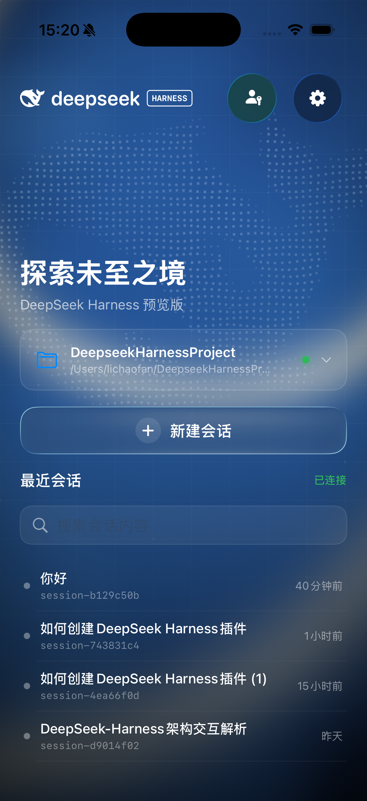</td>
    <td width="33.33%" align="center"></td>
    <td width="33.33%" align="center">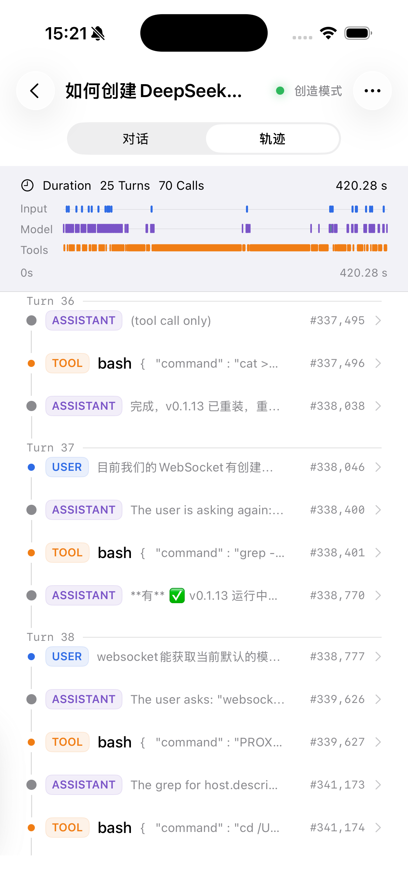</td>
  </tr>
  <tr>
    <td align="center"><strong>Accueil</strong><br>Espaces de travail et sessions récentes</td>
    <td align="center"><strong>Conversation</strong><br>Markdown, code et résultats des outils</td>
    <td align="center"><strong>Trace de l’Agent</strong><br>Vue des durées et chronologie des événements</td>
  </tr>
</table>

### Réglages par défaut

<table>
  <tr>
    <td width="33.33%" align="center">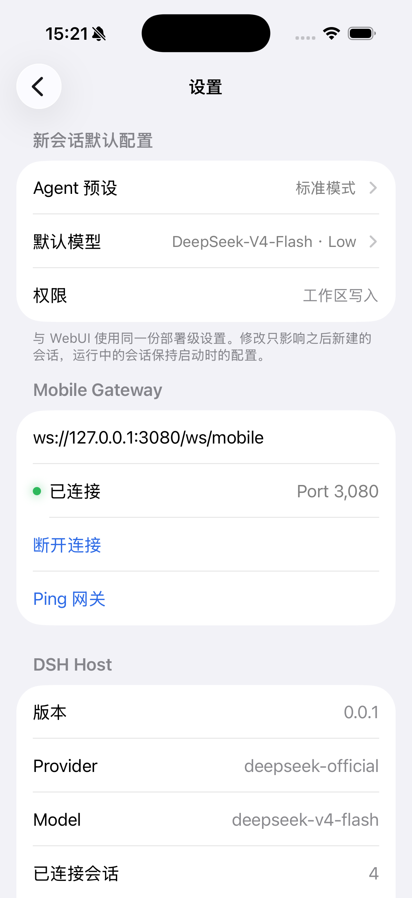</td>
    <td width="33.33%" align="center">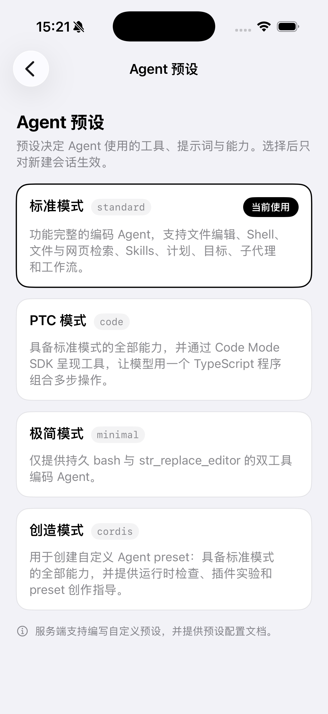</td>
    <td width="33.33%" align="center">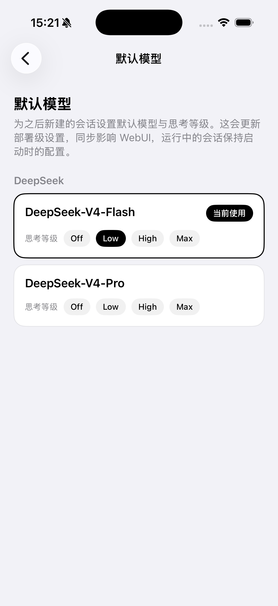</td>
  </tr>
  <tr>
    <td align="center"><strong>Réglages</strong><br>Valeurs de déploiement et état du Gateway</td>
    <td align="center"><strong>Préréglages de l’Agent</strong><br>Outils, instructions et capacités</td>
    <td align="center"><strong>Modèle par défaut</strong><br>Fournisseur, modèle et niveau de raisonnement</td>
  </tr>
</table>

### Plugins et tâches planifiées

<table>
  <tr>
    <td width="50%" align="center"></td>
    <td width="50%" align="center"></td>
  </tr>
  <tr>
    <td align="center"><strong>Gestion des plugins</strong><br>Consulter les détails et l’état d’activation</td>
    <td align="center"><strong>Tâches planifiées</strong><br>Consulter la planification et l’état d’exécution</td>
  </tr>
</table>

<details>
<summary>Autres écrans : espaces de travail, détails des traces et appairage</summary>

### Actions des espaces de travail et détails des traces

<table>
  <tr>
    <td width="33.33%" align="center">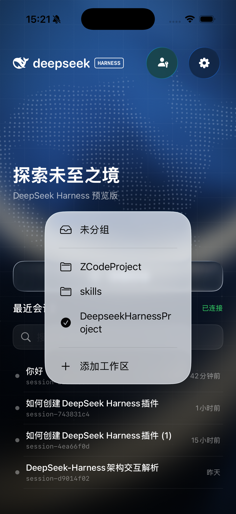</td>
    <td width="33.33%" align="center">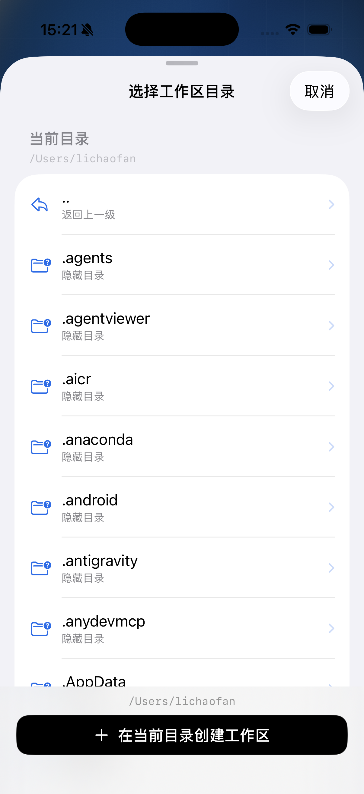</td>
    <td width="33.33%" align="center">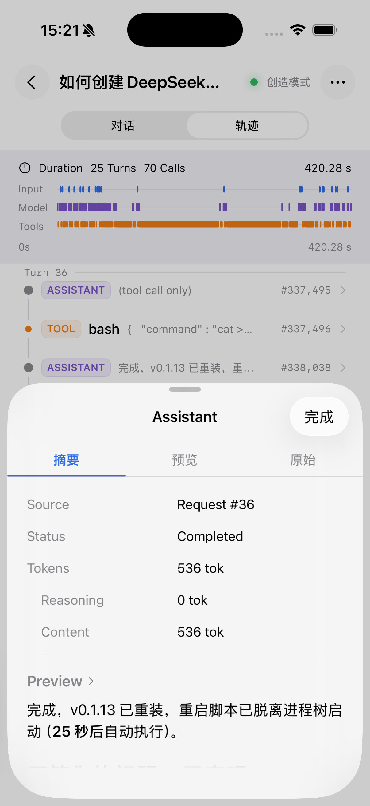</td>
  </tr>
  <tr>
    <td align="center"><strong>Changer d’espace de travail</strong><br>Accéder à différents projets</td>
    <td align="center"><strong>Choisir un répertoire</strong><br>Parcourir et créer des espaces de travail</td>
    <td align="center"><strong>Détails de la trace</strong><br>Résumé, tokens et aperçu du contenu</td>
  </tr>
</table>

### Modes clair et sombre et appairage

<table>
  <tr>
    <td width="33.33%" align="center">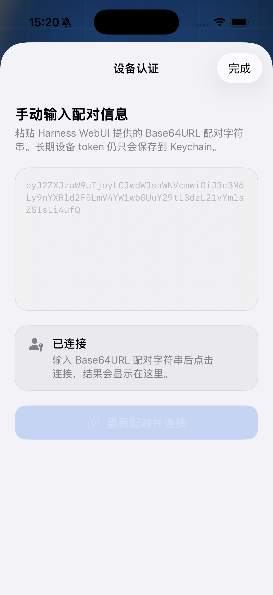</td>
    <td width="33.33%" align="center">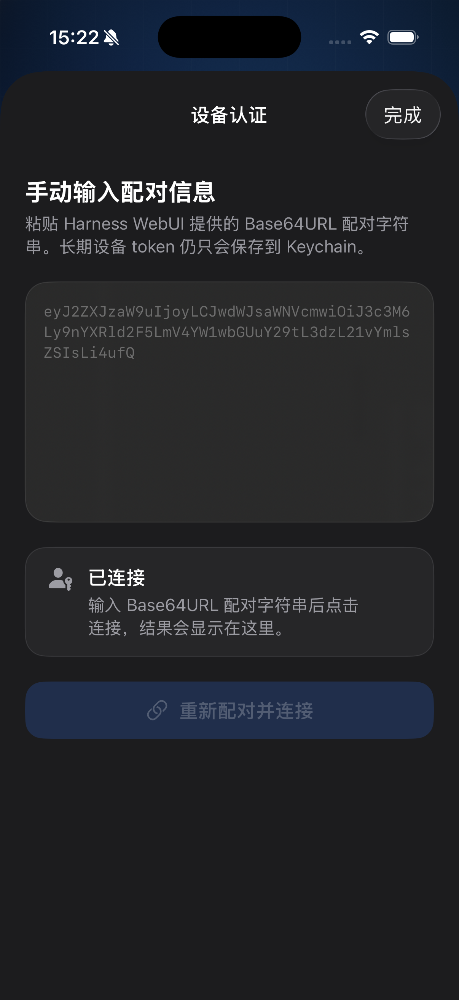</td>
    <td width="33.33%" align="center">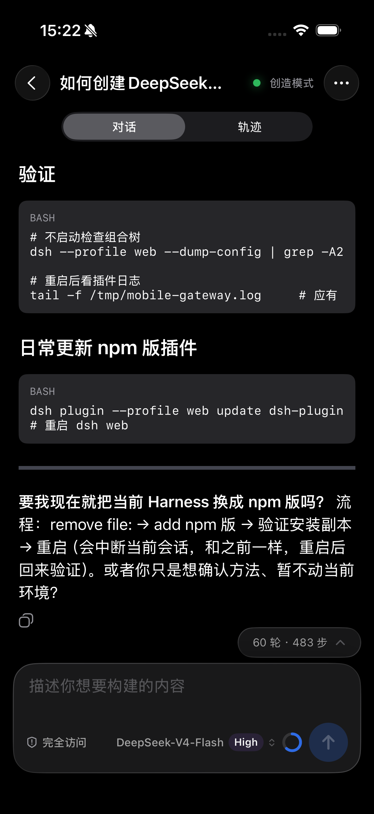</td>
  </tr>
  <tr>
    <td align="center"><strong>Appairage en mode clair</strong><br>Scanner un QR ou saisir les informations</td>
    <td align="center"><strong>Appairage en mode sombre</strong><br>Apparence sombre native</td>
    <td align="center"><strong>Conversation en mode sombre</strong><br>Lecture, code et zone de saisie</td>
  </tr>
</table>

</details>

</details>

## Architecture multiplateforme

```text
                         DeepSeek Harness
                                │
                  dsh-plugin-mobile-gateway
                                │
                             WebSocket
                ┌───────────────┴───────────────┐
                │                               │
     Android OkHttp Transport          iOS URLSession GatewayClient
                │                               │
       KMP Gateway Runtime             Swift Router / KMP Adapter
                │                               │
                └───────────────┬───────────────┘
                                │
                    KMP shared / commonMain
            Protocol · Store · Reducer · Projection
       History Sync · Question/Approval · Workspace Files
                ┌───────────────┴───────────────┐
                │                               │
       Jetpack Compose                     SwiftUI / UIKit
          Android UI                          iOS UI
```

### Responsabilités du module partagé

- `protocol/` : DTO Gateway, représentations JSON et décodage des données du protocole.
- `gateway/` : interfaces de transport, appairage, authentification, corrélation des requêtes, reconnexion et contre-pression des événements. Android utilise l’intégralité du runtime partagé, avec OkHttp comme transport sous-jacent.
- `domain/` : réducteurs pour les sessions, questions, approbations et contrôle des sessions.
- `projection/` : projections incrémentales des conversations et traces.
- `sync/` : pagination de l’historique, fusion des événements récents en direct et déduplication.
- `facade/` : stores, intentions et événements de haut niveau pour les adaptateurs Swift/Kotlin ; chemins, ordre des blocs, progression et vérification SHA-256.

Le module partagé ne dépend ni de Compose, ni de SwiftUI, ni d’Android Framework, ni des frameworks UI Apple. iOS réutilise les stores, réducteurs, projections et machines à états des fichiers. Son `GatewayClient` Swift gère encore les connexions WebSocket et la reconnexion, en transmettant les événements au module partagé via un adaptateur ; iOS n’utilise pas encore tout KMP Gateway Runtime.

Chaque plateforme gère le stockage sécurisé, les images, les fichiers temporaires, le partage/l’ouverture système et le cycle de vie. Le module partagé prend en charge le protocole des fichiers distants, les transitions d’état, la cohérence des blocs et l’intégrité sans accéder directement aux systèmes de fichiers des plateformes.

## Structure du dépôt

```text
.
├── shared/                         # Kotlin Multiplatform business logic
│   └── src/
│       ├── commonMain/             # Protocol, state machines, projections, sync, facades
│       └── commonTest/             # Cross-platform unit tests
├── androidApp/                     # Native Android app (Jetpack Compose)
│   └── src/
│       ├── main/                   # App code and platform integrations
│       ├── test/                   # JVM tests
│       └── androidTest/            # Device tests
├── DeepSeekHarnessMobile/          # Native iOS app (SwiftUI/UIKit)
├── DeepSeekHarnessMobileTests/     # iOS XCTest tests
├── DeepSeekHarnessMobile.xcodeproj
├── Docs/                           # Research, KMP migration, and validation
└── Design/                         # Design specifications and artwork
```

## Environnement de développement

### Prérequis communs

- Java 17.
- DeepSeek Harness avec `dsh-plugin-mobile-gateway` 0.11.1 ou version ultérieure activé.
- Un simulateur, émulateur ou appareil physique pouvant accéder à Mobile Gateway.

### Android

- Android Studio ou les outils en ligne de commande du SDK Android.
- Android SDK Platform 36 (`compileSdk` / `targetSdk`).
- Un appareil ou émulateur sous Android 7.0 (API 24) ou version ultérieure.

### iOS

- macOS et Xcode 26 ou version ultérieure avec le SDK iOS 26 pour compiler les API comme Liquid Glass. La version minimale de déploiement est iOS 16.1.
- Un simulateur ou appareil physique sous iOS 16.1 ou version ultérieure.
- SDK Android : la phase de compilation Xcode appelle Gradle pour compiler le framework KMP.
- Une chaîne d’outils Metal disponible, détectée automatiquement lors de la compilation.

## Exécuter Android

1. Configurez Java 17 et faites pointer `ANDROID_HOME` ou `ANDROID_SDK_ROOT` vers le SDK Android.
2. Compilez un APK Debug depuis la racine du dépôt :

   ```bash
   ./gradlew :androidApp:assembleDebug
   ```

3. Installez-le sur un appareil connecté ou un émulateur :

   ```bash
   ./gradlew :androidApp:installDebug
   ```

4. Lancez `DshMobile` et scannez le QR d’appairage WebUI ou saisissez les informations manuellement.

L’APK Debug est généré dans :

```text
androidApp/build/outputs/apk/debug/androidApp-debug.apk
```

Pour qu’un émulateur Android accède à `127.0.0.1:3080` sur l’hôte, exécutez d’abord :

```bash
adb reverse tcp:3080 tcp:3080
```

## Exécuter iOS

1. Configurez Java 17 et le SDK Android.
2. Ouvrez `DeepSeekHarnessMobile.xcodeproj` dans Xcode.
3. Sélectionnez le schéma `DeepSeekHarnessMobile` et l’appareil cible.
4. Compilez et exécutez. La phase `Build KMP Framework` choisit et compile automatiquement le framework Kotlin/Native adapté.
5. Scannez le QR d’appairage WebUI dans l’application ou saisissez les informations manuellement.

Il n’est pas nécessaire de compiler le framework manuellement au préalable. Pour compiler uniquement le framework du simulateur iOS sur Apple Silicon :

```bash
./gradlew :shared:linkDebugFrameworkIosSimulatorArm64
```

## Connexion et appairage

1. Installez ou mettez à jour `dsh-plugin-mobile-gateway` dans DeepSeek Harness (minimum 0.11.1), puis quittez complètement `dsh web` et relancez-le :

   ```bash
   dsh plugin --profile web add dsh-plugin-mobile-gateway@latest
   ```

2. Ouvrez le panneau des appareils mobiles de WebUI et activez les connexions mobiles et l’authentification des appareils.
3. Vérifiez que l’appareil mobile ou le simulateur peut atteindre le point de terminaison WebSocket.
4. Générez un QR/jeton d’appairage à usage unique et authentifiez-vous dans l’application Android ou iOS.
5. Revenez à l’accueil, vérifiez que Gateway est connecté, puis choisissez un espace de travail et une session.

Points de terminaison courants :

| Environnement | Point de terminaison |
| --- | --- |
| Simulateur iOS | `ws://127.0.0.1:3080/ws/mobile` |
| Émulateur Android avec `adb reverse` | `ws://127.0.0.1:3080/ws/mobile` |
| Appareil physique sur le même réseau local | `ws://<HOST-LAN-IP>:3081/ws/mobile` |
| Déploiement public | `wss://<your-domain>/ws/mobile` |

> [!IMPORTANT]
> Un téléphone physique ne peut pas accéder à votre ordinateur via `127.0.0.1`. Les exemples `ws://` sont réservés au développement local sur un réseau de confiance. Sur un réseau public ou non fiable, utilisez `wss://` avec TLS et authentification des appareils correctement configurés. Ne placez pas de jetons d’appairage à usage unique dans les journaux, issues ou messages.

> [!NOTE]
> Sur le réseau local, les appareils physiques utilisent le listener distinct du port `3081` fourni par `dsh-plugin-mobile-gateway`. Il ne traite que les requêtes authentifiées vers `/ws/mobile` ; les autres chemins renvoient 404. Le port `3080` appartient à DSH WebUI et n’écoute que sur l’interface de bouclage : les appareils physiques ne peuvent donc pas s’y connecter.

## Compilation et tests

Exécutez les tests unitaires Android, lint et la compilation APK :

```bash
./gradlew \
  :androidApp:testDebugUnitTest \
  :androidApp:lintDebug \
  :androidApp:assembleDebug
```

Exécutez les tests partagés Kotlin/Native sur macOS avec Apple Silicon :

```bash
./gradlew :shared:iosSimulatorArm64Test
```

Avec un appareil ou émulateur Android disponible, exécutez les tests sur appareil :

```bash
./gradlew :androidApp:connectedDebugAndroidTest
```

Pour les tests iOS, sélectionnez le schéma `DeepSeekHarnessMobile` dans Xcode, puis **Product → Test**. La compilation lie automatiquement `DeepSeekHarnessShared.framework` pour l’architecture choisie.

## Documentation associée

Certains documents techniques liés sont actuellement disponibles uniquement en chinois.

- [Étude des fonctions et du protocole Harness / WebUI](../exploration.md)
- [Spécification du design mobile](../../Design/design-spec.md)
- [Mentions relatives aux tiers](../third-party-notices.md)

Les documents suivants décrivent la migration KMP et l’implémentation Android. Pour l’état actuel, consultez ce README et le code source :

- [Guide de développement KMP](../kmp-development.md)
- [Validation Android Gateway, phase 12](../kmp-stage12-android-gateway-verification.md)
- [Validation Android UI, phase 13](../kmp-stage13-android-ui-verification.md)

## État du projet

Whaleness est en développement actif. Le module partagé KMP et les applications natives Android et iOS sont implémentés. Le protocole, la cohérence entre plateformes et l’expérience mobile continuent d’évoluer avec DeepSeek Harness et Mobile Gateway.

Il s’agit d’un client tiers pour DeepSeek Harness, développé de manière indépendante.

[](https://dsh-plugin.org/plugins/clarklevis1995/dsh-plugin-mobile-gateway)

### Notes de version intégrées

Les écrans d’informations des deux applications utilisent `AppRelease/release-info.json` et `AppRelease/release-notes.md`. Le champ JSON `version` doit correspondre à la version de l’application ; `minimumGatewayVersion` indique la version minimale du plugin Mobile Gateway. Le Markdown contient les notes de cette version. Les applications lisent ces ressources intégrées localement, sans télécharger le texte.

La skill de publication double KMM écrit les notes validées et synchronise les versions des ressources avant compilation. Elle vérifie que les ressources de l’APK, de l’AAB et du bundle iOS correspondent aux sources et restaure les ressources et fichiers de version si le packaging échoue. Modifier les notes nécessite de recompiler les applications ; modifier seulement le répertoire de sortie ne met pas à jour le contenu intégré.

### Compilation Metal iOS depuis Android Studio

La phase `Build Metal Library` exécute `scripts/build_metal_library.sh`, trouve une chaîne d’outils Metal installée et écrit `default.metallib` dans le bundle. Elle supprime les variables `TOOLCHAINS` et `SDKROOT` injectées par Android Studio uniquement dans son sous-processus, tout en conservant explicitement le SDK iOS et la cible de déploiement courants. Cela évite les fausses erreurs d’outils Metal absents dues au forçage de `XcodeDefault`.

### Sources de mise à jour Android

Android consulte d’abord `https://download.whaleness.cc/latest.json`, puis utilise GitHub Releases si la requête échoue ou si la configuration est invalide. La configuration `schemaVersion: 1` contient `version`, `versionCode`, `packageName`, `downloadUrl`, `size` et `sha256`, ainsi que les champs facultatifs `githubDownloadUrl` et `releaseNotes`. Les téléchargements n’acceptent que les domaines accélérés de confiance configurés et les URL GitHub du projet. Si la source accélérée échoue, l’application utilise le repli et vérifie taille, SHA-256, version, nom du paquet et signature selon la même configuration.

La publication téléverse d’abord un APK versionné immuable, puis met à jour le `latest.json` racine. Les manifestes de mise à jour doivent éviter le cache CDN ; les APK peuvent être mis en cache. Sans nouvelle compilation disponible, aucune requête GitHub n’est envoyée. La vérification au démarrage reste silencieuse ; les vérifications manuelles dans les réglages affichent leur résultat.

### Publication automatique sur R2

Exécutez `python3 scripts/configure_r2_release.py` pour enregistrer les identifiants de lecture/écriture d’objets S3 du bucket configuré dans `~/.config/whaleness/r2-release.json` avec les permissions `600`. `sh scripts/r2_release.sh --check` vérifie seulement la connexion. `sh scripts/r2_release.sh --prepare <release-directory>` génère un manifeste ; `--publish <release-directory>` effectue la publication distante. Le SDK S3 est installé dans l’environnement isolé `build/r2-tools`.

Si la configuration locale existe, la skill de publication double KMM publie automatiquement : validation des paquets locaux, téléversement d’un APK immuable dont le nom contient le numéro de build, vérification de l’objet distant et du téléchargement public, puis mise à jour conditionnelle de `latest.json`. Un échec peut être retenté avec le même répertoire sans recompiler. Définissez `R2_UPLOAD=0` pour un packaging local uniquement. Les vérifications complètes peuvent générer des lectures R2 ; la vérification initiale de connexion ne modifie aucun objet distant.
